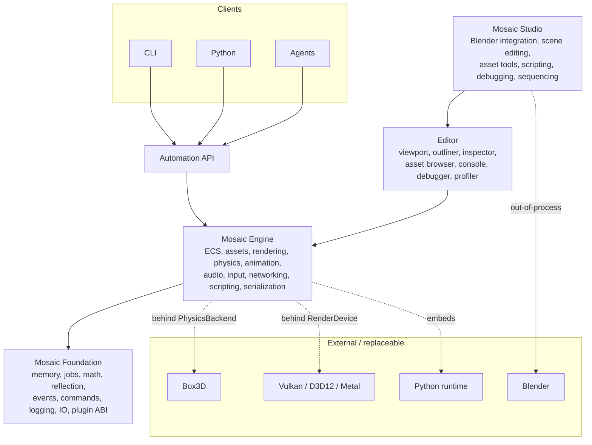
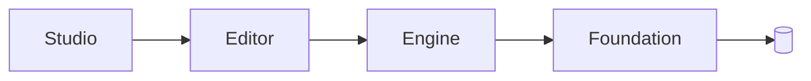

# Mosaic Architecture

Mosaic is a **platform, not an application**. It has three layers, plus an
automation layer above them and replaceable external implementations below.

## The three tiers

The tiers, from the top down:

- **Studio** — the full development environment. Knows about the Editor *and*
  Blender. Hosts the Blender live-link preview and all authoring tools.
- **Editor** — a collection of tools that manipulate engine state through commands
  and events. Knows about the Engine, not about Blender.
- **Engine** — the standalone runtime. Scene/ECS, assets, rendering, physics,
  animation, audio, input, networking, scripting, serialization.
- **Foundation** — deliberately small: memory, jobs, math, reflection, events,
  commands, logging, IO, plugin ABI. Knows about nothing above it.

### The sacred rule

> **Foundation does not know about Blender.**
> **Engine does not know about Blender.**
> **Studio knows about both.**

External implementations (Blender, Box3D, Vulkan, Python) are replaceable and sit
*behind interfaces* — never referenced directly from the tiers that consume them.
See [boundaries.md](boundaries.md).

## Dependency rules

Directory ownership communicates architecture. If someone has to ask "can this
file depend on the editor?", the structure already answers.

**Allowed:**

- `Engine → Foundation`
- `Editor → Engine`
- `Studio → Editor`

**Forbidden (enforced in CI):**

- `Foundation → Engine`
- `Foundation → Editor`
- `Engine → Editor`
- `Engine → Blender`
- `Engine → AI`

Modules may depend on the interfaces they implement, but never on arbitrary editor
code. These rules are what keep the architecture from slowly rotting as
contributors add features.

(The forbidden edges are intentionally *not* drawn — they must never exist.)

## Things Mosaic Will Never Do

This is a guardrail, maintained deliberately. The hardest part of a ten-year
open-source project is not inventing features — it is preventing future
contributors from accidentally destroying the architecture while adding them.

- The runtime will never require the editor.
- The engine will never require AI.
- The core will never depend on Blender.
- The public engine API will never expose Box3D types.
- Plugins will not require modifying core source.
- Automation will not require simulating mouse/keyboard input.
- AI features will never be mandatory.
- The project format will not depend on a proprietary service.
- A rendering backend will not define the engine's rendering API.

When a proposed change conflicts with an item on this list, the change is wrong,
not the list. Amendments to this list require an [RFC](../rfcs/).
