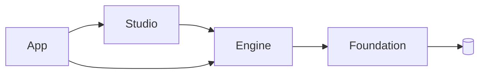

# Mosaic Architecture

Mosaic is a **platform, not an application**. It has three layers, plus an
automation layer above them and replaceable external implementations below.

## The three tiers

```mermaid
graph TD
    subgraph Clients
        CLI[CLI]
        PY[Python]
        AG[Agents]
    end
    APP[Mosaic App<br/>CLI + MCP automation API,<br/>project/plugin/asset management,<br/>the composition root (main) for every binary]
    STUDIO[Mosaic Studio<br/>Blender integration, viewport, outliner,<br/>inspector, asset tools, scripting, debugging]
    ENGINE[Mosaic Engine<br/>ECS, assets, rendering, physics, animation,<br/>audio, input, networking, scripting, serialization]
    FOUND[Mosaic Foundation<br/>memory, jobs, math, reflection,<br/>events, commands, logging, IO, plugin ABI]

    CLI --> APP
    PY --> APP
    AG --> APP
    APP --> STUDIO
    APP --> ENGINE
    STUDIO --> ENGINE
    ENGINE --> FOUND

    subgraph External[External / replaceable]
        BLENDER[Blender]
        BOX3D[Box3D]
        VULKAN[Vulkan / D3D12 / Metal]
        PYTHON[Python runtime]
    end
    STUDIO -.out-of-process.-> BLENDER
    ENGINE -.behind PhysicsBackend.-> BOX3D
    ENGINE -.behind RenderDevice.-> VULKAN
    ENGINE -.embeds.-> PYTHON
```

The tiers, from the top down:

- **App** — the composition root: `main()` for every `mosaic` binary, the CLI
  subcommand surface (`run`/`editor`/`create`/`build`/`import`/`docs`/`plugin`/`mcp`),
  and the MCP automation API agents drive. Wires Engine and Studio together into
  actual executables (`mosaic editor` constructs and drives a `StudioApp`); Studio
  itself never depends back on App. This tier absorbed the original design's
  "Automation API" concept and became the actual process entry point, since
  something has to own `main`.
- **Studio** — the full development environment: viewport, outliner, inspector,
  asset tools, console, play/stop, plugin host, and the Blender live-link preview
  (out-of-process). Knows about the Engine, not about App.
- **Engine** — the standalone runtime. Scene/ECS, assets, rendering, physics,
  animation, audio, input, networking, scripting, serialization.
- **Foundation** — deliberately small: memory, jobs, math, reflection, events,
  commands, logging, IO, plugin ABI. Knows about nothing above it.

*(This repo never grew a separate `editor/` directory — the original design's
Editor and Studio tiers collapsed into one `studio/`, and the Automation API
became the concrete `app/` tier described above. Docs are worded to match what
was actually built, confirmed by grepping every `#include` direction in the
tree, not the original aspirational layout.)*

### The sacred rule

> **Foundation does not know about Blender.**
> **Engine does not know about Blender.**
> **Studio knows about both.**

External implementations (Blender, Box3D, Vulkan, Python) are replaceable and sit
*behind interfaces* — never referenced directly from the tiers that consume them.
See [boundaries.md](boundaries.md).

## Dependency rules

Directory ownership communicates architecture. If someone has to ask "can this
file depend on Studio?", the structure already answers. Tiers map onto real
top-level directories: Foundation → `foundation/`, Engine → `engine/`,
Studio → `studio/`, App → `app/` (`modules/*` sit alongside Engine — each depends
only on the interface it implements, e.g. `modules/render_vulkan` on Engine's
`RenderDevice`, never on App or Studio).

**Allowed:**

- `Engine → Foundation`
- `Studio → Engine`
- `App → Engine`
- `App → Studio`
- `Modules → Engine`

**Forbidden (enforced in CI — see `tools/ci/check_dependency_rules.py`):**

- `Foundation → Engine`
- `Foundation → Studio`
- `Foundation → App`
- `Foundation → Modules`
- `Engine → Studio`
- `Engine → App`
- `Engine → Modules`
- `Studio → App`
- `Modules → Studio`
- `Modules → App`
- `Engine → Blender`
- `Engine → AI`

Modules may depend on the interfaces they implement, but never on arbitrary
Studio or App code. These rules are what keep the architecture from slowly
rotting as contributors add features. The last two (`Engine → Blender`,
`Engine → AI`) have no dedicated directory to check yet — no `blender/` or `ai/`
tree exists in this repo today — so the lint can't mechanically enforce them
until one does; until then they're a review-time guardrail, not a checked one.



(The forbidden edges are intentionally *not* drawn — they must never exist.)

## Things Mosaic Will Never Do

This is a guardrail, maintained deliberately. The hardest part of a ten-year
open-source project is not inventing features — it is preventing future
contributors from accidentally destroying the architecture while adding them.

- The runtime will never require the editor.
- The engine will never require AI.
- The core will never depend on Blender.
- The public engine API will never expose Box3D types.
- Plugins will not require modifying core source.
- Automation will not require simulating mouse/keyboard input.
- AI features will never be mandatory.
- The project format will not depend on a proprietary service.
- A rendering backend will not define the engine's rendering API.

When a proposed change conflicts with an item on this list, the change is wrong,
not the list. Amendments to this list require an [RFC](../rfcs/).
