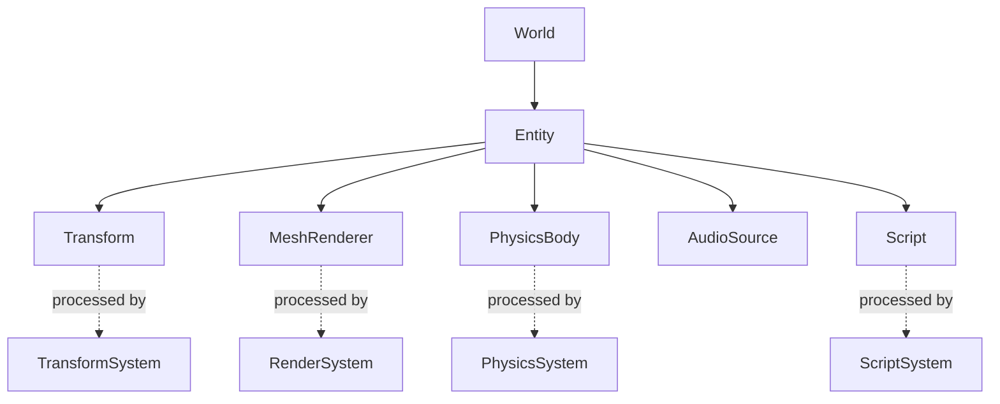

# Mosaic Data Model

The data model is the foundation everything else grows around. Get these
definitions right and most of the engine can evolve without rewriting the core
every six months. This document defines the primitives; the formal proposal is
[RFC 0001](../rfcs/0001-core-data-model.md).

Each primitive is described by: **what it is**, **what owns it**, **how it
serializes**, and **how Python sees it**.

## The primitives

### Entity

- **What:** An identity — nothing more. Not the object; a stable handle
  (`EntityID`) that components attach to.
- **Owns:** Nothing. It is an ID within a World.
- **Serializes:** As a UUID plus the set of components referencing it.
- **Python:** `entity = world.create_entity("Player")` → an opaque handle with
  `.id`, `.components`, `.get(Component)`.

### Component

- **What:** Plain data attached to an entity (Transform, MeshRenderer,
  PhysicsBody, AudioSource, Script). Components hold state; they contain no
  behavior.
- **Owns:** Its own fields.
- **Serializes:** Via reflection — the field metadata drives serialization
  automatically (see [reflection](../design/reflection.md)).
- **Python:** `entity.add(Transform(position=(0,1,0)))`; fields are reflected
  properties.

### System

- **What:** Behavior. A system processes components of interest each tick
  (TransformSystem, RenderSystem, PhysicsSystem, ScriptSystem).
- **Owns:** No entity state; it operates over components.
- **Serializes:** Systems are configuration, not scene data; their enablement and
  parameters live in project/world config.
- **Python:** Systems are registered on a World; scripts usually author
  components and let systems run.

### World

- **What:** A runtime container — loaded scenes, entities, systems, and live
  runtime state. This is where simulation happens.
- **Owns:** Entities and their components; the active system set.
- **Serializes:** Worlds are runtime constructs; what persists is the scenes they
  load plus runtime save-state (a save system concern, later).
- **Python:** `world = mosaic.World()`; `world.load(scene)`.

### Scene

- **What:** An **asset** describing a set of entities/components (MainMenu.scene,
  Level01.scene, Character.scene). A prefab is a scene used as a building block.
- **Owns:** A serialized graph of entities and component data.
- **Serializes:** Human-readable project metadata format; references assets by
  UUID.
- **Python:** `scene = mosaic.load_asset("scenes/level01.scene")`.

### Asset

- **What:** Any addressable content item (mesh, material, texture, scene,
  animation).
- **Owns:** `UUID, type, version, source, dependencies, metadata`, plus import
  settings and generated artifacts.
- **Serializes:** Metadata is human-readable; the cooked runtime artifact is a
  separate binary (see [asset pipeline](../design/asset-pipeline.md)).
- **Python:** `asset = project.assets.get(uuid)`; `asset.dependencies`.

### Resource

- **What:** The loaded, ready-to-use runtime form of an asset (a GPU mesh, a
  decoded texture). The distinction: **Asset = addressable content; Resource =
  the loaded instance.**
- **Owns:** Runtime memory/handles.
- **Serializes:** Not directly; resources are produced from cooked assets at load.
- **Python:** Usually implicit; accessed through components that reference assets.

### Command

- **What:** A mutating action with `ID, params, permissions, execute, undo,
  serialization` (CreateEntity, SetProperty, AddComponent, ImportAsset,
  BuildProject). See [command/event system](../design/command-event-system.md).
- **Owns:** Its parameters and undo record.
- **Serializes:** Fully — commands are the transaction log.
- **Python / agent:** `{"command": "scene.create_entity", "name": "Player"}` — the
  same command a UI button issues.

### Event

- **What:** An announcement that state changed (EntityCreated, ComponentChanged,
  PhysicsContact, BuildCompleted). Events never mutate; they notify.
- **Owns:** An immutable payload.
- **Serializes:** For telemetry/replay; not required for scene persistence.
- **Python:** `world.on(EntityCreated, handler)`.

### Module

- **What:** A unit of engine capability (Renderer, Physics, Animation, AI). May be
  static (compiled in) or dynamic.
- **Owns:** Its systems, components, and registered commands.
- **Serializes:** Listed in the project file (`modules:`), not in scene data.
- **Python:** Discoverable via the module registry.

### Plugin

- **What:** Third-party extension packaged against the plugin ABI (native
  `.dll/.so/.dylib`) or as a Python package. Extends the platform without
  modifying core source.
- **Owns:** Whatever modules/tools it provides.
- **Serializes:** Referenced by the project; versioned.
- **Python:** Python plugins are ordinary importable packages registered with
  Mosaic.

### Property & Reference

- **Property:** A reflected field on a component/asset — the atom the inspector,
  serializer, animation system, and agent API all operate on.
- **Reference:** A typed link to another entity, asset, or resource (by UUID),
  resolved at load. References make the graph serializable and relocatable.

## How it fits together

## Serialization stance

- **Human-readable project metadata** (JSON/TOML-like) for scenes, assets, and
  project config.
- **Binary runtime resources** for cooked, load-ready data.
- Every asset carries `UUID, type, version, source, dependencies, metadata`.

The **schema matters more than the syntax.** Whether the on-disk format ends up
JSON, TOML, or YAML is deferred until the serialization design is validated; what
is fixed here is the set of fields and their meaning.
