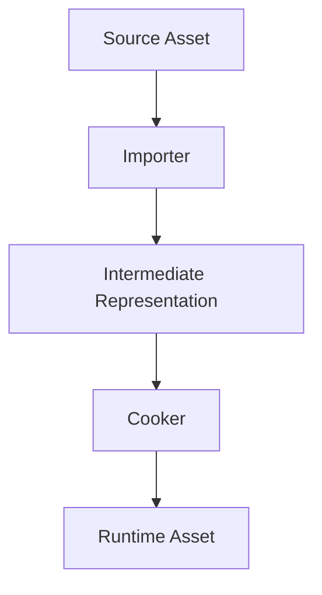
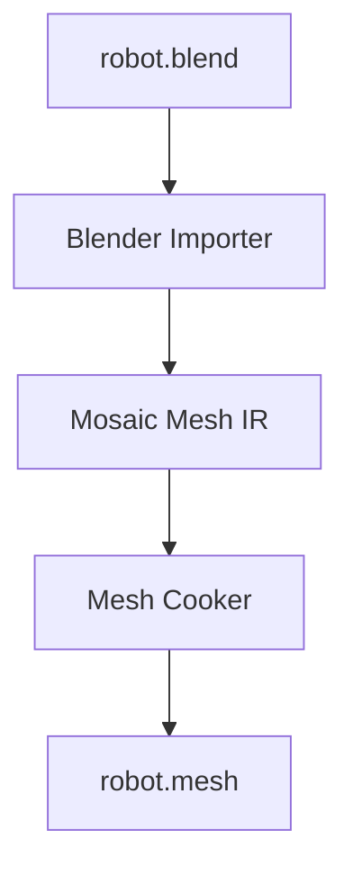
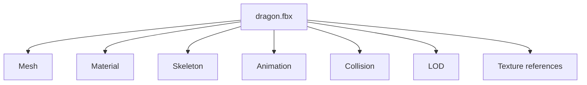

# Asset Pipeline

The asset pipeline is one of the earliest systems, because it quietly becomes one
of the most important. It encodes a decision that shapes the whole platform:

> **Blender is a source authoring tool, not the runtime file format.**

## The flow

Concretely:

The `.blend` is a *source*. The cooked `robot.mesh` is what the runtime loads —
a different, optimized artifact. The runtime never parses `.blend`.

## Content-addressed, dependency-aware

Every asset carries `UUID, type, version, source, dependencies, metadata`. Because
dependencies are tracked, the pipeline knows exactly what to rebuild when a source
changes:

Change `dragon.fbx`, and the pipeline recooks precisely those derived artifacts —
nothing more. This dependency graph is what turns the editor into an IDE for 3D
worlds: builds are incremental and correct.

## Why the separation matters

- **The runtime stays lean.** It links no DCC, parses no authoring formats.
- **Sources stay authoritative.** Artists keep working in Blender (or later, any
  `IAssetAuthoringBackend` — see [boundaries](../architecture/boundaries.md));
  Mosaic ingests canonical assets.
- **Cooking can target platforms.** The same IR can cook differently for desktop,
  web, or a headless server without touching the source.

The Asset and Resource primitives are defined in the
[data model](../architecture/data-model.md); the cooked runtime form is a
Resource produced from a cooked Asset at load time.
