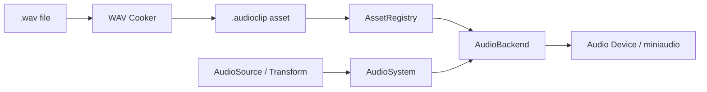

# Audio

The audio subsystem is backend-neutral. No engine or gameplay code interacts with
low-level audio driver APIs (ALSA, PulseAudio, WASAPI, CoreAudio, miniaudio) directly.
All audio processing, voice lifecycle, and spatialization happen behind the
`AudioBackend` boundary. See the [audio boundary](../architecture/boundaries.md#5-the-audio-boundary).

## Structure

```text
AudioSubsystem
   ├── AudioBackend     (device & mixer abstraction)
   ├── AudioSystem      (ECS traversal & voice sync)
   ├── AudioClip        (PCM resource representation)
   ├── AudioSource      (reflected component: clip, gain, pitch, spatial, looping)
   └── AudioListener    (reflected component: spatial listener marker)
```

Backends live under `modules/`:

```text
modules/audio_miniaudio/
```

**miniaudio ships first.** It provides a lightweight, zero-dependency, cross-platform
baseline with built-in format decoding, sample-rate conversion, and 3D spatialization.
However, the interface is backend-neutral from day one; alternative backends (such as
SDL_mixer, FMOD, or Wwise) can be plugged in without changing engine or component code.

## The Audio Pipeline



1. **Asset Pipeline:**
   - Uncompressed 16-bit PCM and 32-bit float WAV files are ingested by `app/asset/audio_cook.hpp`.
   - Ingested audio is normalized to float32 PCM and serialized into binary `.audioclip` assets (`MOSAAUD1`).
   - Project assets are loaded into `AssetRegistry` and transferred to `AudioBackend` via `register_clip()`.

2. **ECS Integration:**
   - `AudioSource` holds the active asset reference (`clip`), volume (`gain`), `pitch`, `looping`, and `spatial` flags.
   - `AudioListener` designates the spatial listener pose (typically attached to the active camera).
   - `AudioSystem` executes once per tick, edge-triggering voice starts/stops on `playing` flag transitions, and updating 3D world positions from `Transform`.

3. **Spatialization & Playback:**
   - When `spatial = true`, the backend computes 3D panning and distance attenuation relative to the listener.
   - For UI, ambient, or non-diegetic sound, `spatial = false` disables spatial attenuation.
   - A null-device backend (`null_device = true`) is provided for deterministic, headless CI execution.
