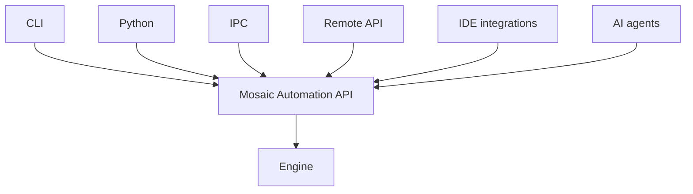

# Automation & Agents

Mosaic does not have an "AI API." It has a **Mosaic Automation API**. AI is one
consumer among many — and not a privileged one.



Because the API is the same one the GUI uses (via
[commands](command-event-system.md)), automation is useful **with or without AI**.
An agent shouldn't "click Blender" — it should issue the same structured commands a
human's clicks resolve to.

## Reading state

Everything meaningful is inspectable through query verbs, for example:

```text
project.list_assets      scene.list_entities
entity.get_components     component.get_properties
asset.inspect             build.status
runtime.get_metrics
```

State is structured data an agent can read directly — no screen capture, no vision
model required to understand the scene.

## Mutating state

All mutation flows through [commands](command-event-system.md):

```json
{ "command": "scene.create_entity", "name": "Player" }
```

A human, a Python script, the CLI, and an agent all issue the same commands. This
is what "the user and the agent are two clients of the same systems" means in
practice.

## Security model

Automation is **permissioned**. An agent (or any client) never gets god mode by
default. Access is granted per scope:

```text
READ_PROJECT      MODIFY_PROJECT
EXECUTE_CODE      EXECUTE_PROCESS
NETWORK_ACCESS    FILE_ACCESS
BUILD_PROJECT     DEPLOY_PROJECT
```

Commands declare the permissions they require; a client acts only within its
granted scopes. Reading a scene, running arbitrary code, spawning processes, and
deploying a build are distinct privileges.

## AI as an optional module

AI lives in `modules/ai/` with providers behind a single interface:

```text
modules/ai/
    assistant/    generation/    agents/
    vision/       code/
```

Providers: local LLM, remote API, vision, embeddings, speech, image generation,
code generation. The core only ever sees `IAgentProvider` — and ideally that
interface lives *above* the Engine.

**When AI is disabled** (`--without-ai`, or the Studio setting
`[ ] Enable AI subsystem`):

- no model initialization
- no network connections
- no AI subprocesses
- no model files loaded
- no hidden inference
- no behavior changes
- no degraded core functionality

A minimal build can exclude the AI module entirely. The engine never depends on
AI — this is one of the
[things Mosaic will never do](../architecture/ARCHITECTURE.md#things-mosaic-will-never-do).

> AI should make a great engine better — not make a mediocre engine appear easier
> to use.
