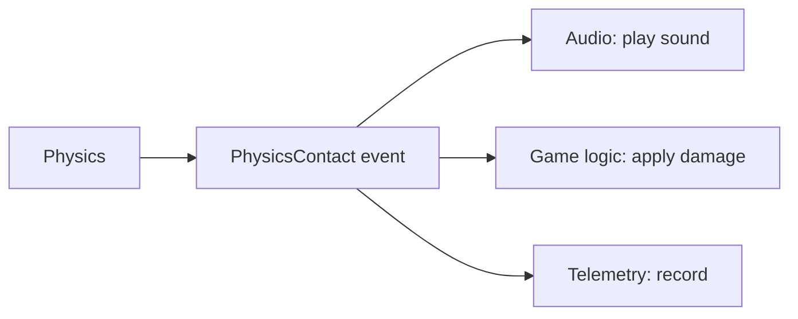

# Commands & Events

Two complementary primitives sit at the heart of Mosaic's automation story:

- **Commands mutate state.** Every mutating action is a command.
- **Events announce state changes.** Events never mutate; they notify.

Together they are how humans and agents end up using *the same software*.

## Commands

Every mutating action goes through a command:

```text
CreateEntity     DeleteEntity     SetProperty
AddComponent     RemoveComponent  MoveAsset
ImportAsset      BuildProject     RunScene
```

Each command has:

```text
ID
parameters
permissions
execution
undo
serialization
```

Because a command carries its own undo and serialization, the same mechanism gives
us undo/redo, macro recording, transaction logs, scripting, and agent actions —
all variations of one thing.

### One command, many callers

A human clicking a button:

```text
Create Entity
```

and an agent sending:

```json
{
  "command": "scene.create_entity",
  "name": "Player"
}
```

are performing **the same operation** through the same command. This is the heart
of the agent architecture: automation is not a parallel path bolted on, it is the
same path the UI uses.

### Undo is command-based

Undo is not "restore the previous editor state." It is the inverse of a command:

```text
CreateEntityCommand   →  undo deletes the entity
SetPropertyCommand    →  undo restores the old value
AddComponentCommand   →  undo removes the component
```

So undo/redo, automation, scripting, and agent actions all reduce to executing and
un-executing commands.

## Events

Commands change state; events announce that it changed:

```text
EntityCreated     ComponentAdded    ComponentChanged
EntityDestroyed   AssetImported     SceneLoaded
PhysicsContact    BuildCompleted
```

Events keep modules decoupled. When physics reports a contact:



Physics does not know Audio, game logic, or telemetry exist. Each subscriber
reacts on its own. New subscribers can be added without touching the producer.

## Relationship to the rest of the system

Commands and events lean on [reflection](reflection.md) (to target properties
generically) and are exposed through the
[automation API](automation-and-agents.md) with per-command
[permissions](automation-and-agents.md#security-model). The
[data model](../architecture/data-model.md) defines Command and Event as
first-class primitives.
