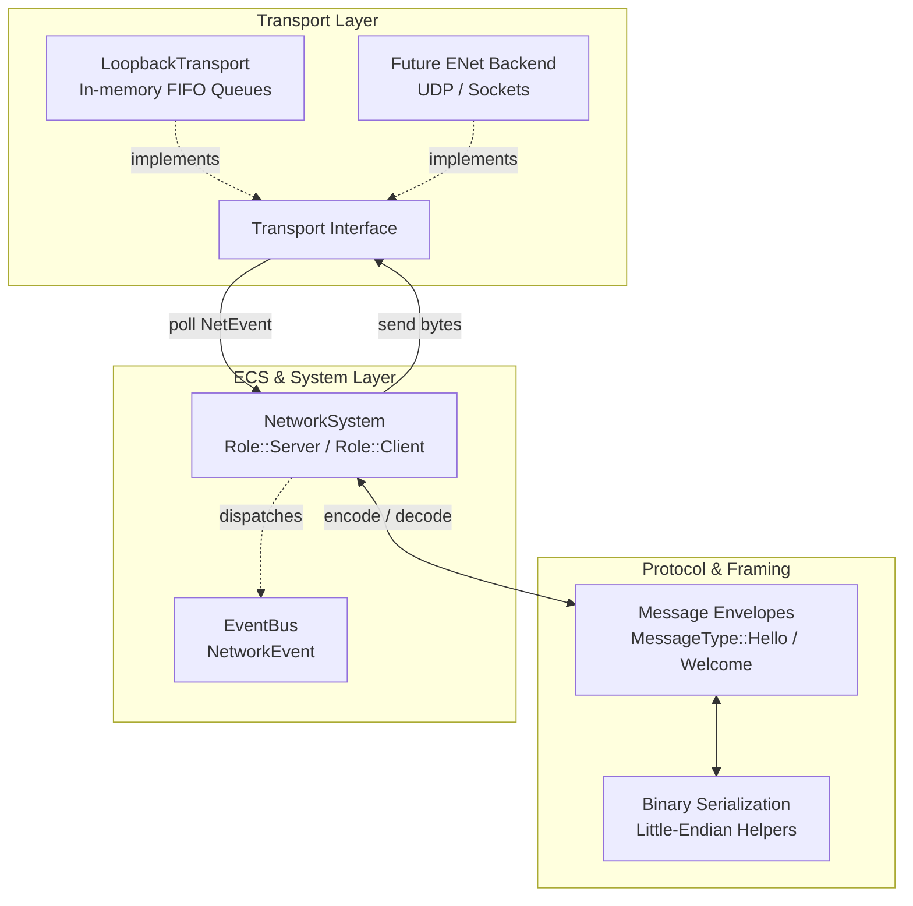

# Networking Subsystem

The networking subsystem provides an asynchronous, transport-neutral, and server-authoritative
multiplayer networking architecture for Mosaic.

In accordance with Mosaic's architectural boundaries:
- **No OS sockets or networking libraries enter engine core**: All transport mechanisms
  are abstracted behind the pure-virtual `Transport` seam (`engine/net/transport.hpp`).
  OS socket APIs (`sys/socket.h`, Winsock) and external libraries (e.g. ENet) are walled
  off in separate modules or test harnesses.
- **Deterministic in-memory testing**: In-process development and headless CI tests utilize
  `LoopbackTransport` (`engine/net/loopback_transport.hpp`), running bidirectional communication
  queues without opening network ports or touching the operating system network stack.
- **Decoupled session lifecycle**: Connection identifiers (`ConnectionId`) managed by the
  underlying transport layer are strictly decoupled from gameplay `SessionId`s assigned by
  `NetworkSystem`.

See [The networking boundary](../architecture/boundaries.md#7-the-networking-boundary).

## Architecture

```text
Networking Subsystem
   ├── Transport Layer   (Transport interface, NetEvent, Channel, LoopbackTransport)
   ├── Message Framing   (MessageType, put_u32 / get_u32 LE helpers, Hello / Welcome envelopes)
   ├── Network Events    (PeerJoined, PeerLeft, SessionEstablished, Disconnected)
   └── ECS Integration   (NetworkSystem, Role::Server, Role::Client, session lifecycle)
```

## The Networking Pipeline



---

## 1. The `Transport` Seam

The transport layer abstracts packet transmission and socket polling behind a clean interface:

```cpp
using ConnectionId = uint64_t;

enum class Channel {
    Reliable,
    Unreliable
};

struct NetEvent {
    enum class Type { Connected, Disconnected, Message };
    Type type;
    ConnectionId connection_id{0};
    Channel channel{Channel::Reliable};
    std::string payload;
};

class Transport {
public:
    virtual void send(ConnectionId conn, Channel channel, std::string_view bytes) = 0;
    virtual std::vector<NetEvent> poll() = 0;
    virtual void disconnect(ConnectionId conn) = 0;
    virtual ~Transport() = default;
};
```

### In-Memory Loopback (`LoopbackTransport`)
For deterministic headless execution and automated test suites, `make_loopback_pair()` provides
paired server and client `Transport` instances connected via synchronized FIFO queues:
- **Zero OS Sockets:** No TCP/UDP bindings, port conflicts, or firewall warnings.
- **Deterministic Delivery:** Orderly FIFO draining, immediate disconnect notifications, and
  predictable event generation.
- **Simulated Channels:** Preserves the distinction between `Channel::Reliable` and
  `Channel::Unreliable` packets without packet drop or out-of-order delivery unless explicitly injected.

---

## 2. Message Framing & Protocol Envelopes

Network messages use a compact binary envelope format:
- Byte 0: `MessageType` (8-bit identifier)
- Bytes 1..N: Type-specific payload (little-endian integers and byte buffers)

```cpp
enum class MessageType : uint8_t {
    Hello   = 1,
    Welcome = 2
};
```

### Serialization Helpers
Binary serialization avoids endianness pitfalls across platforms using explicit little-endian
encoding:
- `put_u32(std::string& buf, uint32_t val)`: Appends 4 bytes in little-endian order.
- `get_u32(std::string_view buf, size_t offset)`: Decodes a 32-bit little-endian integer.

### Core Handshake Frames
| Message | Payload Structure | Direction | Purpose |
|---|---|---|---|
| `Hello` | 1 byte header (`0x01`) | Client $\rightarrow$ Server | Initial connection greeting requesting session assignment. |
| `Welcome` | 1 byte header (`0x02`) + 4 bytes `assigned_id` (LE) | Server $\rightarrow$ Client | Acknowledgment establishing session ID for the connected peer. |

---

## 3. Session Lifecycle & `NetworkSystem`

The `NetworkSystem` is an `ecs::System` running during `World::tick()`:
```cpp
class NetworkSystem : public ecs::System {
public:
    enum class Role { Server, Client };
    NetworkSystem(std::shared_ptr<Transport> transport, Role role);
    void tick(World& world, float dt) override;
    ...
};
```

### Roles and Responsibilities
1. **Server Role (`Role::Server`):**
   - Polls transport events every tick.
   - On receiving `MessageType::Hello` from a new `ConnectionId`:
     - Assigns a monotonic `SessionId` (starting from 1).
     - Records mapping `ConnectionId` $\leftrightarrow$ `SessionId`.
     - Encodes and sends `MessageType::Welcome` containing `assigned_id`.
     - Dispatches `PeerJoined { session_id }` onto the `EventBus`.
   - On transport `Disconnected`:
     - Looks up associated `SessionId`.
     - Removes session mapping.
     - Dispatches `PeerLeft { session_id }`.
2. **Client Role (`Role::Client`):**
   - On initial connection, transmits `MessageType::Hello` to the host.
   - On receiving `MessageType::Welcome`:
     - Adopts the server-assigned `local_id`.
     - Marks connection as established (`is_connected() == true`).
     - Dispatches `SessionEstablished { session_id }` onto the `EventBus`.
   - On disconnect, clears `local_id` and dispatches `Disconnected`.

---

## 4. Subsystem Roadmap & Next Steps

The networking subsystem follows a structured, milestone-driven decomposition:
- **Slice N1 (Done, PR #136):** Neutral `Transport` interface and in-memory `LoopbackTransport`.
- **Slice N2 (Done, PR #137):** Protocol message framing, session lifecycle, and Hello/Welcome handshake via `NetworkSystem`.
- **Slice N3 (Next Buildable):** Server-authoritative component state replication (`ComponentReflection` $\rightarrow$ `Value` snapshots).
- **Slice N4:** Entity replication (spawn, despawn, and network entity ID mapping).
- **Slice N5:** Client-to-server command and input streaming via `CommandStack`.
- **Slice N6:** ENet UDP production backend module (`modules/net_enet`) with `mosaic run --host` / `--connect` CLI integration.
