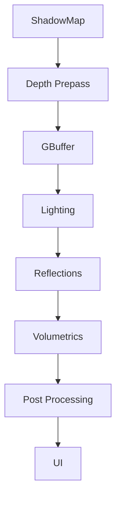

# Rendering

The renderer is backend-neutral. No engine or game code touches Vulkan, D3D12, or
Metal objects directly — it works in engine concepts, and a backend implements
them. See the [render boundary](../architecture/boundaries.md#3-the-render-boundary).

## Structure

```text
Renderer
   ├── RenderDevice   (backend abstraction)
   ├── RenderGraph    (passes + resources)
   ├── Resources
   ├── Pipelines
   └── Passes
```

Backends live under `modules/`:

```text
modules/render_vulkan/
modules/render_d3d12/
modules/render_metal/
modules/render_webgpu/
```

**Vulkan ships first.** It gives a strong cross-platform baseline and forces the
abstraction to be honest — if the interface can express Vulkan cleanly, the other
backends fit. But the interface is backend-neutral from day one; a backend never
defines the engine's rendering API.

## The render graph is first-class, early

Rather than hard-coded calls:

```cpp
draw_shadows();
draw_world();
draw_postfx();
```

Mosaic describes resources and passes, and the graph resolves dependencies:



Making the render graph a foundational concept early buys us, over time:

- automatic synchronization
- transient resource management
- pass reordering
- debugging and render-graph visualization
- backend-specific optimization

Developers can add, remove, and rearrange passes without rewriting the backend.

## Higher-level concepts

Systems above the device deal only in:

```text
Mesh   Material   Texture   Shader
Camera Light      Pass      RenderGraph
```

These map to reflected data (see [reflection](reflection.md)) so materials and
cameras are inspectable, serializable, and scriptable like any other component.
