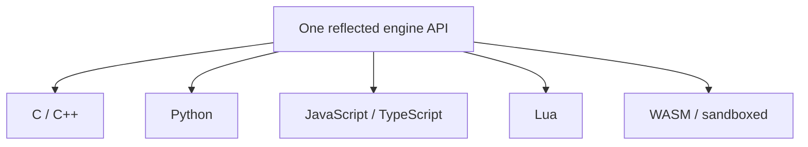

# Scripting

Mosaic is multi-language at the API level from the start, even though it ships one
language first. There is **one underlying reflected engine API**; every language
targets it.

## Python first

The primary embedded language is **Python**, because:

- Blender already speaks Python — shared muscle memory for the audience.
- The ecosystem is enormous and ideal for tooling and automation.
- It is approachable, and it is ideal for agents.

Python bindings are generated from [reflection](reflection.md), so scripts see the
same properties, components, commands, and events the inspector and the automation
API see. There is no separate scripting data model to maintain.

## One reflected API, many languages



The reflected surface — `Entity, Component, Property, Method, Event, System` —
exposes metadata, so every language binding, the editor inspectors, documentation
generation, serialization, and agent manipulation all derive from the same
information. Add a language binding later without redefining the engine API.

## Plugin tiers

Scripting is one of three extension mechanisms (see the
[data model](../architecture/data-model.md) for Module/Plugin):

```text
Static modules       compiled into the engine (Renderer, Physics, Platform)
Dynamic native       .dll / .so / .dylib  (tools, importers, gameplay, systems)
Script plugins       Python packages       (experimentation, automation, glue)
```

Together these give maximum performance (static/native) plus maximum flexibility
and easy experimentation (script). A contributor can prototype in Python and
graduate hot paths to a native module without changing the engine.

## v0.1 scope

The first slice ships **Python embedding, reflection bindings, and command
access** — enough to write a script that manipulates entities and presses Play.
Additional languages and hot-reload come later on the
[roadmap](../project/roadmap.md).

## Studio plugins (Plugin SDK, Phase 5)

The "Script plugins" tier above now has a real Studio-facing entry point: a
project-local `plugins/*.py` file can register menu items that run with the same
reflected globals a gameplay `ScriptComponent` gets
(`create_entity`/`destroy_entity`/`is_valid`, `get_component`/`set_component`/
`add_component`/`remove_component`/`has_component`/`component_names`,
`entities`/`entity_count`/`entities_with`, `emit`, and the undo trio
`undo`/`redo`/`undo_depth`). A plugin declares its menu items as a plain module-level
dict:

```python
MOSAIC_MENU_ITEMS = {"Say Hello": "on_say_hello"}

def on_say_hello():
    print("hello from a plugin!")
```

`studio/plugin_host.hpp`/`.cpp` gives each discovered `.py` file its **own** isolated
`ScriptEngine` (no shared globals between plugin files), reads `MOSAIC_MENU_ITEMS`
back out through a small, genuinely neutral addition to `ScriptEngine` —
`get_global`/`call_function` — so Studio never links pybind11/Python.h directly (the
Scripting Boundary above holds for plugins too, not just gameplay scripts). A plugin
that fails to load, or whose `MOSAIC_MENU_ITEMS` is malformed, is skipped and logged to
the Console panel; it never blocks its siblings or crashes Studio. Full design:
[2026-09-13 Plugin SDK discovery + menu items spec](../superpowers/specs/2026-09-13-plugin-sdk-discovery-menu-items-design.md).
Eight worked examples, one per major capability, live in
[`tools/example_plugins/`](../../tools/example_plugins/).

This is slice 1 of the Plugin SDK (discovery/lifecycle + menu items only). Custom
Studio panels and custom asset importers are separate, later slices; native
`.so`/`.dll` dynamic-library plugins (the "Dynamic native" tier above) are a much
heavier, still-later sub-project — this slice is Python-only.

### Custom Studio panels (slice 2)

A plugin can also declare `MOSAIC_PANELS`, the panel-registration counterpart to
`MOSAIC_MENU_ITEMS`:

```python
MOSAIC_PANELS = {"My Panel": "draw_my_panel"}

def draw_my_panel():
    imgui_text("hello from a plugin panel")
```

Studio adds the panel to its dockable layout (`StudioLayout::add_panel`) and calls the
named function once per frame while the panel is open, inside the panel's own
`ImGui::Begin`/`End` — the function's `imgui_*` calls append to that window exactly
like native ImGui code would. Nine globals are available: `imgui_text`,
`imgui_separator`, `imgui_same_line`, `imgui_spacing`, `imgui_button`,
`imgui_checkbox`, `imgui_input_text`, `imgui_slider_float`, and
`imgui_begin_child`/`imgui_end_child` for scroll regions.

This needed a second, Studio-only `ScriptEngine` implementation
(`modules/script_python_studio`) — the one place pybind11 and ImGui coexist, the same
pattern `modules/render_vulkan` uses for Vulkan headers. `modules/script_python`
itself still has zero ImGui dependency, and `studio/` still has zero pybind11
dependency; every plugin engine `PluginHost` creates now comes from the richer module,
but the Script Console/Editor (used for ad-hoc gameplay scripting, not panel drawing)
keep using the plain one — calling an `imgui_*` global outside an active panel draw
would corrupt ImGui's internal state.

### Custom asset importers (slice 3)

A plugin can also declare `MOSAIC_IMPORTERS`, the import-registration counterpart to
`MOSAIC_MENU_ITEMS`/`MOSAIC_PANELS` -- keyed by file extension instead of a UI label,
since this one has no UI surface (see below):

```python
import csv
import json

MOSAIC_IMPORTERS = {".csv": "import_csv"}

def import_csv(source_path):
    with open(source_path, newline="") as f:
        rows = list(csv.reader(f))
    return json.dumps(rows)
```

`mosaic import <project> <file>` -- the CLI import command, not the editor -- consults
every plugin's `MOSAIC_IMPORTERS` for the source file's extension whenever that
extension isn't one of the four built-in kinds (`.py`/`.wav`/`.ttf`/`.otf`, plus the
PPM image fallback). The matched function receives the source file's path as its one
argument and does its own file I/O (`open()`, and any stdlib module it imports, are
both available -- an importer plugin is regular Python, same as any other plugin
file); its **return value** (a string) becomes the asset's cooked blob, written to
`assets/<stem>.data` alongside the usual `assets/<stem>.toml` metadata.

This is register-only in v1: an imported asset is loaded back as a raw string via
`AssetRegistry::load<std::string>(id)`, with no gameplay-script getter yet -- add one
against real demand, the same "grow later" call slice 2 made for the `imgui_*`
widget set. There's also no Studio UI trigger: Studio's Assets panel stays
read-only, and importing only happens through the `mosaic import` CLI command -- a
project's `plugins/` directory here resolves as `<project_dir>/plugins` (the CLI
already takes an explicit project directory, unlike the editor's CWD-relative gap
documented below).

This needed a new app-tier plugin loader, `ImportPluginHost`
(`app/asset/import_plugins.hpp`/`.cpp`), structurally parallel to `studio::PluginHost`
but never calling `bind_world`/`bind_commands` and deliberately not built on top of
`PluginHost` directly -- `mosaic_app` does privately link `mosaic_studio` (for
`run/editor.cpp`'s Studio launcher), but `app/CMakeLists.txt` keeps that dependency
(and ImGui/pybind11-studio with it) off every other app-tier header on purpose;
`asset_io.hpp` is included widely, so pulling `studio::PluginHost` in here would leak
Studio's dependency chain into code that has no business carrying it. No `ScriptEngine`
interface changes were needed either: an importer's return value is captured by
composing `set_global` + `run_string` + `get_global`, all of which the interface
already exposed.

### Where the plugins directory lives

`plugins/` is resolved against the project directory, not the process's current
working directory: `app/project/project_io.hpp`'s `resolve_plugins_dir(path)` derives
`<path>/plugins` from `Options::open_path` (the CLI's positional project-dir/scene-file
argument), threaded into `Options::plugins_dir` in `app/main.cpp` the same place
`Options::assets_dir` already is, and passed into `StudioApp`'s constructor for
`plugin_host_.load()` to use (`studio_app.cpp`). `mosaic editor <path>` run from any
working directory picks up `<path>/plugins` correctly -- a desktop file association,
an "Open with Mosaic" launcher, a shortcut, or a packaged distribution's launcher all
work the same way, since none of them can be relied on to set a particular CWD.

When `open_path` isn't actually a directory (a bare scene file, or nothing given),
`resolve_plugins_dir` returns `nullopt` and `StudioApp` falls back to its constructor's
default of a bare `"plugins"` literal -- CWD-relative, matching the old behavior for
that one case, since there's no project directory to resolve against.
