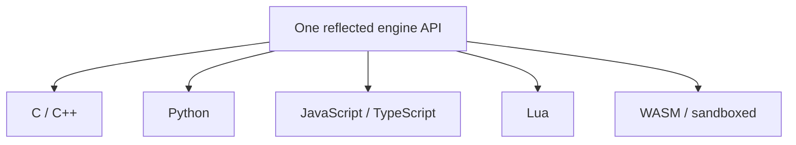

# Scripting

Mosaic is multi-language at the API level from the start, even though it ships one
language first. There is **one underlying reflected engine API**; every language
targets it.

## Python first

The primary embedded language is **Python**, because:

- Blender already speaks Python — shared muscle memory for the audience.
- The ecosystem is enormous and ideal for tooling and automation.
- It is approachable, and it is ideal for agents.

Python bindings are generated from [reflection](reflection.md), so scripts see the
same properties, components, commands, and events the inspector and the automation
API see. There is no separate scripting data model to maintain.

## One reflected API, many languages



The reflected surface — `Entity, Component, Property, Method, Event, System` —
exposes metadata, so every language binding, the editor inspectors, documentation
generation, serialization, and agent manipulation all derive from the same
information. Add a language binding later without redefining the engine API.

## Plugin tiers

Scripting is one of three extension mechanisms (see the
[data model](../architecture/data-model.md) for Module/Plugin):

```text
Static modules       compiled into the engine (Renderer, Physics, Platform)
Dynamic native       .dll / .so / .dylib  (tools, importers, gameplay, systems)
Script plugins       Python packages       (experimentation, automation, glue)
```

Together these give maximum performance (static/native) plus maximum flexibility
and easy experimentation (script). A contributor can prototype in Python and
graduate hot paths to a native module without changing the engine.

## v0.1 scope

The first slice ships **Python embedding, reflection bindings, and command
access** — enough to write a script that manipulates entities and presses Play.
Additional languages and hot-reload come later on the
[roadmap](../project/roadmap.md).
