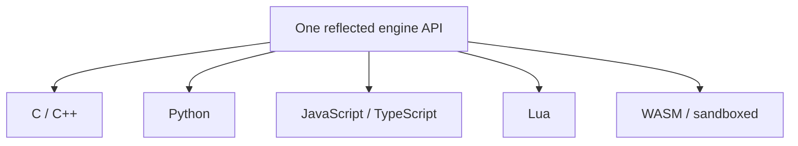

# Scripting

Mosaic is multi-language at the API level from the start, even though it ships one
language first. There is **one underlying reflected engine API**; every language
targets it.

## Python first

The primary embedded language is **Python**, because:

- Blender already speaks Python — shared muscle memory for the audience.
- The ecosystem is enormous and ideal for tooling and automation.
- It is approachable, and it is ideal for agents.

Python bindings are generated from [reflection](reflection.md), so scripts see the
same properties, components, commands, and events the inspector and the automation
API see. There is no separate scripting data model to maintain.

## One reflected API, many languages



The reflected surface — `Entity, Component, Property, Method, Event, System` —
exposes metadata, so every language binding, the editor inspectors, documentation
generation, serialization, and agent manipulation all derive from the same
information. Add a language binding later without redefining the engine API.

## Plugin tiers

Scripting is one of three extension mechanisms (see the
[data model](../architecture/data-model.md) for Module/Plugin):

```text
Static modules       compiled into the engine (Renderer, Physics, Platform)
Dynamic native       .dll / .so / .dylib  (tools, importers, gameplay, systems)
Script plugins       Python packages       (experimentation, automation, glue)
```

Together these give maximum performance (static/native) plus maximum flexibility
and easy experimentation (script). A contributor can prototype in Python and
graduate hot paths to a native module without changing the engine.

## v0.1 scope

The first slice ships **Python embedding, reflection bindings, and command
access** — enough to write a script that manipulates entities and presses Play.
Additional languages and hot-reload come later on the
[roadmap](../project/roadmap.md).

## Studio plugins (Plugin SDK, Phase 5)

The "Script plugins" tier above now has a real Studio-facing entry point: a
project-local `plugins/*.py` file can register menu items that run with the same
reflected globals a gameplay `ScriptComponent` gets
(`create_entity`/`destroy_entity`/`is_valid`, `get_component`/`set_component`/
`add_component`/`remove_component`/`has_component`/`component_names`,
`entities`/`entity_count`/`entities_with`, `emit`, and the undo trio
`undo`/`redo`/`undo_depth`). A plugin declares its menu items as a plain module-level
dict:

```python
MOSAIC_MENU_ITEMS = {"Say Hello": "on_say_hello"}

def on_say_hello():
    print("hello from a plugin!")
```

`studio/plugin_host.hpp`/`.cpp` gives each discovered `.py` file its **own** isolated
`ScriptEngine` (no shared globals between plugin files), reads `MOSAIC_MENU_ITEMS`
back out through a small, genuinely neutral addition to `ScriptEngine` —
`get_global`/`call_function` — so Studio never links pybind11/Python.h directly (the
Scripting Boundary above holds for plugins too, not just gameplay scripts). A plugin
that fails to load, or whose `MOSAIC_MENU_ITEMS` is malformed, is skipped and logged to
the Console panel; it never blocks its siblings or crashes Studio. Full design:
[2026-09-13 Plugin SDK discovery + menu items spec](../superpowers/specs/2026-09-13-plugin-sdk-discovery-menu-items-design.md).
Eight worked examples, one per major capability, live in
[`tools/example_plugins/`](../../tools/example_plugins/).

This is slice 1 of the Plugin SDK (discovery/lifecycle + menu items only). Custom
Studio panels and custom asset importers are separate, later slices; native
`.so`/`.dll` dynamic-library plugins (the "Dynamic native" tier above) are a much
heavier, still-later sub-project — this slice is Python-only.

### Where the plugins directory lives (and its known gap)

Today, `plugins/` is resolved as a **literal path relative to the process's current
working directory** at the moment Studio loads plugins (`studio_app.cpp`'s
`plugin_host_.load("plugins", ...)`) — the same implicit convention scenes and assets
already use elsewhere in Studio. In practice this means: **run `mosaic editor` from
inside your project directory**, and a `plugins/` folder next to it is picked up
correctly.

This is a real, documented gap, not an oversight to silently work around: `mosaic
editor <path>` (and `mosaic run <path>`) already accepts an explicit project directory
or scene file as a positional argument (`app/cli/options.hpp`'s `Options::open_path`,
threaded into `Options::assets_dir` for asset loading) — but the process never
`chdir()`s to match it, so passing that argument does **not** currently make plugin
discovery (or, more broadly, every other CWD-relative path in Studio) follow it. For an
installed/packaged distribution — a desktop file association, an "Open with Mosaic"
launcher, a shortcut — the process's CWD at startup is not guaranteed to be the project
directory at all, and plugin discovery (along with scene/asset resolution generally)
would silently find nothing.

**Follow-up, not yet scheduled:** resolve `plugins/` (and ideally every other
project-relative path in Studio) against an explicit, tracked project root instead of
CWD. The project system already has the right shape to build this on — `mosaic.toml`
(`app/project/project.hpp`'s `kManifestName`) plus `app/project/project_io.hpp`'s
`load_manifest(project_dir)`, both already used by `mosaic create`/`mosaic build` with
an explicit `project_dir` string, never CWD. `mosaic editor`/`mosaic run` would need to
thread that same explicit project directory through to `StudioApp` (today they only
partially do, via `assets_dir`) rather than each CWD-relative path site guessing it
independently.
