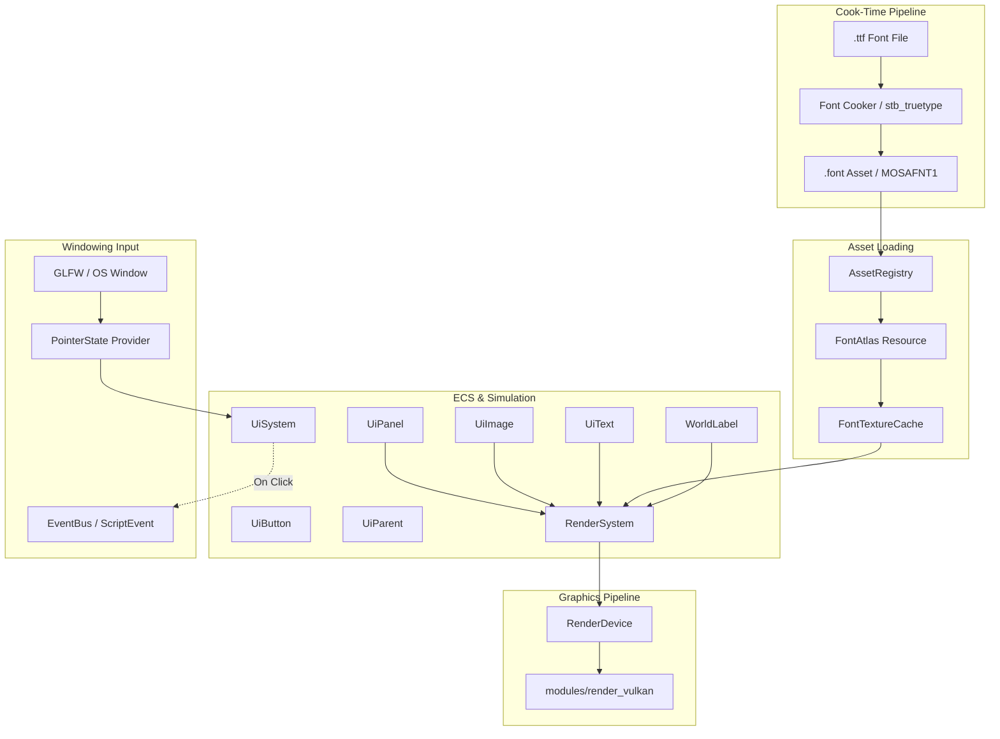

# User Interface (UI)

The UI subsystem provides a lightweight, backend-neutral, and windowing-agnostic
runtime heads-up display (HUD) and 2D canvas framework.

In accordance with Mosaic's architectural boundaries:
- **No windowing libraries (GLFW, SDL, Win32) enter the engine**: Input is abstracted
  via a neutral `PointerState` provider function injected at runtime setup.
- **No font rasterizers (stb_truetype, FreeType) enter the runtime**: Font compilation
  is strictly cook-time; the runtime only loads cooked `.font` binary assets into a
  neutral `FontAtlas` resource.
- **No graphics driver APIs (Vulkan, D3D12) enter the UI system**: All drawing happens
  behind abstract `RenderDevice` seams (`draw_ui`, `draw_ui_image`, `draw_ui_text`).

See [The UI and input boundary](../architecture/boundaries.md#6-the-ui-and-input-boundary).

## Structure

```text
UISubsystem
   ├── Layout & Geometry (Anchor enum, resolve_rect, resolve_in, layout_text)
   ├── Image Presentation (ui_fit.hpp: resolve_image_quad -- sub-rects + Stretch/Fit/Fill)
   ├── Hit Resolution    (ui_hit.hpp: topmost_hit -- z-order overlap resolution)
   ├── Hierarchy         (UiParent, ui_hierarchy resolver, depth-capped cycle safety)
   ├── Asset Pipeline    (stb_truetype, font_cook, MOSAFNT1, FontAtlas)
   ├── ECS Components    (UiPanel, UiText, UiImage, UiButton, UiParent, WorldLabel)
   ├── Render Passes     (draw_ui, draw_ui_image, draw_ui_text, draw_world_text, FontTextureCache)
   ├── World-Space Text  (build_world_text, WorldLabel, camera-facing billboard glyphs)
   └── Interaction       (PointerState seam, UiSystem, ScriptEvent dispatch)
```

## The UI Pipeline



---

## 1. Layout & Anchoring Model

Screen-space positions are defined relative to 9 canonical viewport anchor points:

```text
TopLeft (0, 0)      TopCenter (0.5, 0)      TopRight (1, 0)
CenterLeft (0, 0.5) Center (0.5, 0.5)       CenterRight (1, 0.5)
BottomLeft (0, 1)   BottomCenter (0.5, 1)   BottomRight (1, 1)
```

- **`resolve_rect(anchor, pos, size, screen_width, screen_height)`**:
  Computes a pixel-space `Rect { x, y, width, height }` from normalized coordinates:
  - `pos` represents an offset in normalized coordinates $[0.0, 1.0]$.
  - `size` represents width and height in normalized coordinates $[0.0, 1.0]$.
  - The anchor point determines the origin offset from the frame's corner/edge/center.
- **`resolve_in(frame, anchor, pos, size)`**:
  Generalized frame-relative rect resolution. When `frame` is `{0, 0, 1, 1}`, it evaluates
  identically to screen-space `resolve_rect`. When `frame` is a parent element's resolved normalized
  rect, child elements are nested seamlessly.

The layout function is a pure, side-effect-free mathematical utility in `engine/ui/ui_rect.hpp` with zero dependencies.

---

## 2. Font Asset Cooking & Text Layout

Mosaic renders crisp, deterministic bitmap text without runtime TrueType parsing overhead:

1. **Cook-Time Rasterization (`app/asset/font_cook.cpp`):**
   - Walled single-header `stb_truetype` v1.26 bakes an ASCII glyph atlas ($32 \dots 126$).
   - Generates an 8-bit alpha coverage bitmap and computes per-glyph metrics:
     - Horizontal metrics: `advance_width`, `left_bearing`
     - Quad bounds: `x0, y0, x1, y1`
     - Texture UVs: `s0, t0, s1, t1`
   - Encodes into binary `.font` assets under the magic header `MOSAFNT1`.
2. **Runtime `FontAtlas` (`engine/ui/font_atlas.hpp`):**
   - Loaded into `AssetRegistry` from compiled `.font` payloads.
   - Holds the raw alpha pixels and lookup table for ASCII codepoint metrics.
3. **Aspect-Correct Text Layout (`engine/ui/text_layout.hpp`):**
   - `layout_text(text, atlas, frame, anchor, pos, height, screen_w, screen_h)` converts a string
     into an array of positioned `UiTextQuad` vertices.
   - Accepts an optional parent container `frame`; text height scales relative to its parent container.
   - Corrects for viewport aspect ratio ($W / H$) so characters maintain uniform proportions across resolutions.
   - Handles whitespace character advancement without emitting empty geometry.

---

## 3. Reflected ECS Components

All UI components are reflected via `ComponentReflection` and can be inspected, serialized, and manipulated via Python scripts:

| Component | Key Fields | Purpose |
|---|---|---|
| `UiPanel` | `anchor`, `pos`, `size`, `color`, `alpha`, `order` | Flat solid-color rectangular HUD elements and container cards. |
| `UiImage` | `texture` (`AssetID`), `anchor`, `pos`, `size`, `sub_rect_pos`, `sub_rect_size`, `fit_mode`, `tint`, `alpha`, `order` | Textured 2D sprites, icons, and decals. `sub_rect_*` select a region in **texture pixels** (zero size = whole texture), so one atlas serves many sprites; `fit_mode` is 0 Stretch / 1 Fit / 2 Fill. |
| `UiText` | `text`, `font` (`AssetID`), `anchor`, `pos`, `size`, `color`, `alpha`, `order` | Aspect-correct formatted single-line text labels. |
| `UiButton` | `anchor`, `pos`, `size`, `event` (`std::string`), `order` | Hit-test region that detects mouse interactions and fires events. `order` resolves overlaps: higher wins. |
| `UiParent` | `parent` (`EntityID`) | Hierarchical link nesting this element within a parent container entity. |
| `WorldLabel` | `font` (`AssetID`), `text`, `size`, `color`, `alpha`, `offset` | 3D camera-facing billboard text floating at entity's `WorldTransform`. |

---

## 4. Rendering Architecture & Seams

UI rendering is divided between in-world text and screen-space HUD passes in `RenderSystem`:

1. **Pass Ordering:**
   - **World-Space Labels:** Rendered after opaque meshes and 3D billboards, but **before** the 2D HUD. Submits via `RenderDevice::draw_world_text()`.
   - **Screen-Space Layer 1 (Panels):** Emitted via `RenderDevice::draw_ui()`.
   - **Screen-Space Layer 2 (Images):** Emitted via `RenderDevice::draw_ui_image()`.
   - **Screen-Space Layer 3 (Text):** Emitted via `RenderDevice::draw_ui_text()`.
   - Within each screen-space layer, components are sorted by their `order` property (ascending).
2. **Vulkan Screen-Space Viewport Inversion:**
   - Swapchain and offscreen passes use a negative-height viewport convention for standard Y-up 3D projection.
   - Screen-space UI vertex shaders (`ui.vert`, `ui_image.vert`, `ui_text.vert`) map normalized top-left coordinates via:
     $$\text{clip.y} = 1.0 - 2.0 \cdot ny$$
     This guarantees that UI coordinates ($0, 0$ at top-left) render right-side up regardless of Vulkan viewport orientation.
3. **Vulkan Pipelines (`modules/render_vulkan/`):**
   - **`ui.vert` / `ui.frag`**: Procedural quad with push-constant bounds and color.
   - **`ui_image.vert` / `ui_image.frag`**: Textured quad sampling bound 2D image assets with push-constant tint.
   - **`ui_text.vert` / `ui_text.frag`**: Alpha coverage glyph sampling multiplied by text color and alpha.
   - **`world_text.vert` / `world_text.frag`**: World-space glyph vertex pipeline with depth-testing enabled (depth writes disabled) and camera view-projection transforms.

---

## 5. Interactive Input & Event System

The UI subsystem introduces Mosaic's first runtime user input pipeline while maintaining complete isolation from third-party windowing APIs:

1. **The `PointerState` Seam (`engine/ui/pointer.hpp`):**
   ```cpp
   struct PointerState {
       float x = 0.0f;      // Normalized cursor X [0.0, 1.0]
       float y = 0.0f;      // Normalized cursor Y [0.0, 1.0]
       bool down = false;
       bool inside = true;  // is a pointer PRESENT over this surface at all?
   };
   ```
   `inside` exists because "there is no pointer" and "the pointer is at the origin" are
   different facts that a position alone cannot distinguish — and `{0, 0}` is a real
   position inside any element anchored `TopLeft` at `{0,0}`, which is what a
   default-constructed `UiButton` is. Hit resolution treats `inside == false` as
   "nothing is hit", whatever the coordinates say.
2. **Windowing Integration (`app/main.cpp`):**
   - In windowed mode, a lambda queries GLFW:
     ```cpp
     glfwGetCursorPos(window, &cx, &cy);
     bool down = glfwGetMouseButton(window, GLFW_MOUSE_BUTTON_LEFT) == GLFW_PRESS;
     return PointerState{ float(cx / width), float(cy / height), down };
     ```
   - In headless mode, tests, or CLI commands, **no provider is installed at all** — the
     `std::function` is left empty and `UiSystem` returns early.

     This is deliberate and was once a bug. A "default null provider" returning
     `{0, 0, false}` reads as a pointer sitting at the top-left corner, so once hover
     events existed, headless runs emitted a `hover_enter` for any element containing the
     origin and never a matching exit. An absent pointer must be expressed by an absent
     provider (or `inside == false`), never by zeroed coordinates.
   - The editor supplies its own provider from the viewport panel
     (`studio/viewport.hpp`), which reports panel-relative coordinates and sets
     `inside` from whether the panel is hovered. It gates `down` on play mode, but **not**
     position: a stopped editor still has a cursor.
3. **`UiSystem` Execution (`engine/ui/ui_system.hpp`):**
   - Runs during `World::tick()` alongside other ECS systems. **Note this means it does
     not run in a stopped editor**, where the loop is halted and `World::tick` never fires.
   - Flattens every `UiButton` into hit candidates **once per update**, and resolves the
     one under the pointer with `topmost_hit` (`engine/ui/ui_hit.hpp`). Press and hover
     share that single resolution, so a click and its hover feedback cannot land on
     different buttons.
   - **Overlap resolution:** higher `order` wins; among equal orders the entity later in
     iteration wins, which matches the draw order in the common case but is not guaranteed
     to (buttons and panels are separate component stores). Author distinct `order` values
     when the resolution matters.
   - Tracks press transitions: a press records the **topmost** button under the pointer, and
     a release clicks only if that button is still the topmost one there.
   - Emits a `ScriptEvent` to the `EventBus` for **three** actions on the button's single
     `event` channel:
     ```json
     {
       "event": "<button.event>",
       "payload": {
         "entity": "<entity_id>",
         "action": "click" | "hover_enter" | "hover_exit"
       }
     }
     ```
   - **A handler MUST filter on `action`.** Until hover existed, `click` was the only
     action, so matching the event *name* alone was correct — and any handler still doing
     that now fires on every pointer crossing. Adding hover had to fix three such handlers
     in this repository, including the demo's own.
   - `hover_enter` fires once on the **transition** onto a button, not while the pointer
     rests inside it. Moving directly from button A to button B emits `hover_exit(A)` then
     `hover_enter(B)`, in that order. Hover is independent of `down`, so it tracks the
     pointer during a drag that began elsewhere.
   - **Rendered hover feedback** is opt-in, via two components:
     - `UiHoverStyle` (authored, reflected) carries `tint` and `alpha_scale`, which
       **multiply** the element's authored colour and alpha. The defaults (`{1,1,1}` and
       `1.0`) are an exact no-op, so adding the component without configuring it changes
       nothing.
     - `UiHovered` is a runtime marker `UiSystem` puts on the hovered entity. It is
       **deliberately not registered** for reflection, so it can never be serialized into a
       scene file — otherwise saving while the cursor rested on a button would persist a
       phantom hover, and loading that scene would start up already highlighted.

     **The ownership rule:** an element is styled by the nearest `UiHoverStyle` at or above
     it in the `UiParent` chain, and only if that chain reaches a `UiHovered`. The two
     searches are independent and both run the whole chain — a style *above* the hovered
     entity still governs it. So a style authored on a panel applies to the labels parented
     inside it **and to a button parented inside it**, and a child can override by authoring
     its own.

     **What does not happen:** hovering a child never styles its parent. The walk only goes
     up, so a hovered button highlights itself (using whatever style governs it) and not the
     panel containing it. If you want the container to react, the container is what needs to
     be hit-testable. A button therefore owns the UI components on its **own entity** —
     which is how every button in this repository is already authored.

     Two limits worth knowing. A style can never **reveal** an element whose authored alpha
     is 0: hidden stays hidden. And hovering with no style anywhere changes nothing — hover
     is not itself a visual state.

     Feedback is applied as a **render-time override**. Nothing writes to `UiPanel::color`,
     `UiImage::tint` or `UiText::color`, so the authored values survive and a scene saved
     mid-hover is unaffected. Scripts may still react to the hover events directly for
     behaviour the style cannot express.
   - Script components and event listeners receive these events via standard
     `on_event(name, payload)` handlers.

---

## 6. Hierarchical Layout & Nesting (Slice U5a)

HUD elements can nest hierarchically using `UiParent`:
- **`UiParent { EntityID parent; }`**: Indicates that an entity's UI geometry is anchored within the resolved bounding frame of its parent entity (which must have a `UiPanel`).
- **Hierarchy Resolution (`engine/ui/ui_hierarchy.hpp`):**
  - Walks the parent chain to accumulate transformed rects (`resolve_parent_frame`).
  - **Cycle Safety:** Chain traversal is capped at a maximum depth of 16 to guard against cyclical parent references.
  - Rects resolve via `resolve_ui_rect(world, entity, screen_w, screen_h)`.
- All render passes (panels, images, text) and `UiSystem` pointer hit-testing route through this unified resolver, ensuring child elements move, scale, and clip with their container.

---

## 7. World-Space 3D Text Labels (Slice U5b)

Floating 3D in-game text (nameplates, damage numbers, objective markers) is implemented via `WorldLabel`:
- **Billboard Geometry (`engine/ui/world_text.hpp`):**
  - `build_world_text()` takes a string, font atlas, anchor position in world space, label size, and the camera's `right` and `up` unit vectors.
  - Emits camera-facing billboard triangles (`WorldGlyphVertex`) centered on the anchor point.
- **Occluded Depth Testing:**
  - Unlike 2D HUD text, world-space text labels run with Vulkan depth testing enabled.
  - Labels are naturally occluded when behind solid geometry (terrain, walls), but depth writing is disabled so labels do not occlude other transparent objects.
