# Mosaic: Advancement Plans, Implementation Evaluation & Next Steps

**Document Version:** 2.1.0  
**Evaluation Date:** 2026-10-31  
**Evaluation Status:** Active / Updated Architectural Evaluation following Completion of Handoff Infrastructure Slices (#330–#334: Handoff Freshness CI Gate, UI Frame-Reach Renderer Gate, Non-Vacuous GPU Validation Capture, and Behavioural Staging Buffer Reset Verification)  
**Repository State:** Phases 0 through 6 Core Subsystems Implemented and Validated (1,629 / 1,629 Unit/Integration Tests Passing, 16 Offscreen GPU Tests Passing under Lavapipe in CI)  

---

## 1. Executive Summary

Mosaic is an open-source, modular 3D development platform engineered with a strict, decoupled architecture (**Foundation**, **Engine**, **Modules**, **Studio**, and **App Shell**). It delivers an extensible runtime with deterministic C17 **Box3D** physics, a modern **Vulkan 1.3** physical-based renderer (PBR), embedded **Python** gameplay scripting, a high-performance **UI and HUD subsystem**, and a first-class **Automation & Agent API (MCP)** that treats humans and autonomous agents as dual clients of the same reflected command-event architecture.

This document represents the formal **v2.1.0 evaluation** of the project's state, succeeding v2.0.0 (2026-10-29). Over the intervening period (#330 through #334), four critical infrastructure and diagnostic slices were implemented, delivering automated handoff freshness checking in CI, offscreen UI frame-reach rendering verification, non-vacuous GPU validation capture, and behavioural testing for staging buffer per-call counter resets. The automated test suite has expanded from 1,621 to 1,629 unit tests and from 10 to 16 offscreen GPU tests.

The purpose of this evaluation is to:
1. **Synthesize the latest advancement plans**, upgrading roadmaps against live requirements, recently shipped feature arcs, and active design specifications (`docs/superpowers/specs/`, `docs/design/`, and `docs/project/deferred-work-backlog.md`).
2. **Evaluate the precise implementation state** across all thirteen engine and tooling subsystems, contrasting delivered functionality with architectural requirements and highlighting newly resolved vs. newly discovered debt.
3. **Establish a prioritized, phased implementation plan** for the remaining frontiers required to transition Mosaic from its current operational milestone into a production-hardened platform.
4. **File this evaluation away traceably** within the documentation hub under standing project rules.

---

## 2. Review of Documentation & Latest Advancement Plans

### 2.1 The Architectural Tiers & Current System Topology

Per [`docs/architecture/ARCHITECTURE.md`](../architecture/ARCHITECTURE.md) and [`docs/architecture/boundaries.md`](../architecture/boundaries.md), Mosaic strictly enforces unidirectional dependency layers guarded by an automated pre-commit and CI dependency-rule linter (`tools/ci/check_dependency_rules.py`):

```mermaid
graph TD
    subgraph Tier4 [Application & CLI]
        APP["App Shell (app/main.cpp)"]
        CLI["CLI Commands (mosaic run / create / build / mcp / docs)"]
    end

    subgraph Tier3 [Authoring & Tooling]
        STUDIO["Studio Workbench (studio/)"]
        BLENDER["Blender Live-Link (External DCC via IPC)"]
        MCP_SRV["Agent API / MCP Server (mosaic mcp)"]
    end

    subgraph Tier2 [Runtime Engine]
        WORLD["World Runtime Container"]
        ECS["Sparse-Set ECS (EntityRegistry / ComponentRegistry)"]
        SCENE["Scene Serialization (JSON Remapping)"]
        ASSET_REG["Asset Registry & Cached Loaders"]
        XFORM["Hierarchical TransformSystem"]
        RUN_LOOP["Fixed-Timestep RuntimeLoop"]
        RENDER_SYS["RenderSystem (PBR / Shadows / UI / VFX / Text)"]
        PHYS_SYS["PhysicsSystem (Box3D Adapter / Raycasts / Impulses)"]
        SCRIPT_SYS["ScriptSystem (Python / ScriptWorker Thread)"]
        UI_SYS["UiSystem (Layout / Clipping / Scrolling / Hit-Testing)"]
        AUDIO_SYS["AudioSystem (miniaudio Backend)"]
        NET_SYS["NetworkSystem (ENet Transport / Replication)"]
    end

    subgraph Tier1 [Hardware & Backend Modules]
        VK_MOD["modules/render_vulkan (VulkanRenderDevice)"]
        BOX3D_MOD["modules/physics_box3d (Box3D Adapter)"]
        GLFW_MOD["GLFW Window & Surface Integration"]
    end

    subgraph Tier0 [Foundation]
        CORE["Core Primitives (EntityID / Handles)"]
        MATH["Foundation Math (Vec3 / Quat / Mat4 Column-Major)"]
        REFLECT["TypeRegistry & Reflection (FieldVisitor)"]
        SERIAL["Value DOM & Codecs (JSON / TOML)"]
        CMD_EVT["CommandStack & Double-Buffered EventBus"]
        LOGGING["Structured Logging (Category / Leveled Sinks)"]
        JOBS["Job System (ThreadPool / parallel_for)"]
    end

    APP --> STUDIO
    APP --> CLI
    CLI --> WORLD
    STUDIO --> WORLD
    MCP_SRV --> WORLD
    BLENDER -. TCP IPC .-> STUDIO

    WORLD --> ECS
    WORLD --> RENDER_SYS
    WORLD --> PHYS_SYS
    WORLD --> SCRIPT_SYS
    WORLD --> UI_SYS
    WORLD --> AUDIO_SYS
    WORLD --> NET_SYS
    WORLD --> XFORM
    WORLD --> SCENE
    WORLD --> ASSET_REG
    WORLD --> RUN_LOOP

    RENDER_SYS --> VK_MOD
    PHYS_SYS --> BOX3D_MOD
    RENDER_SYS --> MATH
    PHYS_SYS --> MATH
    XFORM --> MATH

    ECS --> CORE
    SCENE --> SERIAL
    SCENE --> REFLECT
    ASSET_REG --> SERIAL
    WORLD --> CMD_EVT
    VK_MOD --> GLFW_MOD
```



### 2.2 Progression of Roadmap Milestones & Recent Feature Arcs

The project roadmap ([`docs/project/roadmap.md`](roadmap.md)) established seven sequential capability phases. The state of each phase across the repository is:

1. **Phase 0 (Foundation) — COMPLETE:** C++20 core primitives, column-major math, type reflection, Value DOM, command stack, deferred event bus, structured logging, thread pool, and test framework.
2. **Phase 1 (First World) — COMPLETE:** ECS runtime, hierarchical transforms, scene serialization, asset registry, Vulkan swapchain, mesh rendering, camera view/projection, directional/point lights, and Studio workbench shell.
3. **Phase 2 (Simulation) — COMPLETE:** Box3D physics adapter, rigid bodies, box/sphere/capsule/hull colliders, raycasts, contact events, `apply_impulse`, click-to-nudge, and multi-thread backend mutex synchronization.
4. **Phase 3 (Programming) — COMPLETE:** Embedded Python C-API runtime, reflection property bindings, `ScriptComponent`, `ScriptSystem`, off-thread `ScriptWorker` with buffered main-thread write dispatch, script profiler, tracepoint debugger, and in-editor script console and hot-reload.
5. **Phase 4 (Production) — COMPLETE:**
   - **Audio:** Neutral backend, miniaudio driver, cooked audio clip asset, `AudioSource`, and `AudioSystem`.
   - **VFX:** Billboard particle emitters with deterministic simulation, over-life easing curves, burst triggers, connected ribbon trails, quad decals, and screen overlay effects.
   - **UI:** Screen HUD foundation, font atlas assets, multi-line text rendering with word-wrap, images/sprites, click/drag interaction with pointer capture, z-order hit resolution, layout containers (`UiStack`, `UiGrid`, `UiFlow`), clipping (`UiClipRect`), and scrolling (`UiScroll`).
   - **Networking:** Neutral transport interface, in-memory loopback, ENet UDP transport, `NetworkSystem`, snapshot state replication, despawn replication, and client-to-server input.
6. **Phase 5 (Tool Ecosystem) — COMPLETE:** Plugin SDK (discovery, lifecycle, custom menu items, panels, importers), local and git-backed plugin package manager, runtime sandboxing, project templates, and documentation tooling.
7. **Phase 6 (Agent Ecosystem) — COMPLETE:** Model Context Protocol (MCP) server (`mosaic mcp`), scene reasoning tools (`describe_scene`, `entities_where`), script synthesis (`set_script`), asset generation (`import_asset`), automated headless simulation testing (`tick`), performance profiling (`script_profile`), and project health inspection (`broken_references`, `bulk_set_field`, `orphaned_assets`).

### 2.3 Latest Advancement Plans & Active Design Frontiers

While foundational capability phases are operating, active development has focused on verification rigor, authoring completeness, and platform maturity:

1. **Test Infrastructure & Verification Hardening (Shipped October 30–31):**
   - **Handoff Staleness Verification (#331):** Automated `tools/docs/check_checked_column_staleness.py` in CI ensuring `next-steps.md` `State` table dates remain fresh relative to value changes.
   - **UI Frame-Reach Renderer Gate (#332):** `UiDrawStats` counter triple and integer bounds checker (`modules/render_vulkan/vulkan_ui_draw_stats.{hpp,cpp}`) verifying UI draw submission in offscreen headless GPU tests (`tests/gpu/offscreen_ui_frame_reached_test.cpp`).
   - **Non-Vacuous GPU Validation (#333):** Published `validation_messages_are_observed()` in `VulkanRenderDevice` and consolidated `tests/gpu/validation_capture.hpp` asserting the Vulkan validation layer was actively attached.
   - **Behavioural Staging Counter Resets (#334):** Abstract `StagingChunkInspector` seam exposing chunk counts; behavioral GPU test (`tests/gpu/offscreen_staging_chunk_reset_test.cpp`) mutation-proven against counter reset deletions.
2. **User Interface (UI) Pillar Advancements:**
   - **U10 (Interactive Navigation & Text Entry):** Keyboard focus navigation (`tab` traversal), gamepad navigation, and active `UiTextInput` widget with caret rendering, backspace, and string entry. Blocked on establishing a formal editor-mode input provider.
   - **9-Slice Panel Scaling:** Nine-quad expansion on cached sub-rect UV machinery to permit scalable HUD borders without corner distortion.
   - **Content-Sized Layout Slots:** Layout containers that size slots based on child extents (requires decoupling layout passes from asynchronous font/asset loading).
   - **Editor Layout Gizmos:** Visual layout boundary overlays for container editing when backdrops do not provide sufficient visual contrast.
3. **Rendering & Visual Advancements:**
   - **Cascaded Shadow Maps (CSM):** Dynamic multi-frustum directional shadows replacing the fixed-orthographic v1 implementation, plus omnidirectional point-light shadow maps.
   - **Dynamic RenderGraph:** Transitioning from direct multi-pass submission to a dynamic acyclic render graph when per-frame pass topologies become runtime-dependent.
   - **Forward+ / Clustered Shading:** Transitioning from UBO-limited light limits to compute-based light grid clustering for scenes with dozens of active spot and point lights.
4. **Authoring & Pipeline Advancements:**
   - **Blender Bidirectional Geometry Sync:** Upgrading the live-link bridge from transform-only synchronization to live vertex/mesh updating.
   - **3rd-Person Adventure Template & Content:** Authorable starter content proving character controller, animation state, and camera interaction.
   - **Integrated Asset Cooker GUI:** Embedding the asset compilation pipeline directly inside the Studio Asset Browser.
   - **`imgui_test_engine` Adoption Decision:** Evaluating automated headless write-back testing for Inspector controls (`DragFloat`, `DragInt`, `InputText`, `Checkbox`).
5. **Networking & Platform Hardening:**
   - **Multiplayer Production Features:** NAT punchthrough, packet compression, DTLS encryption, and client-side prediction with server reconciliation.
   - **Native Dynamic Library Plugins:** Dynamic `.so`/`.dll` plugin loading with cross-platform ABI stability and native sandboxing.

---

## 3. Comprehensive Evaluation of Implementation State

### 3.1 Subsystem Implementation Scorecard

Every major engine and tooling subsystem has been analyzed against architectural contracts, functional capabilities, and test coverage:

| Subsystem / Component | Implementation Location | Architectural Contract & Role | Implementation State & Verification Status |
|---|---|---|:---:|
| **Core Primitives & Math** | `foundation/core/`, `foundation/math/` | `EntityID` handle recycling with generation caps; column-major `Vec3`, `Quat`, `Mat4`, Vulkan clip-space projections, `inverse_affine`. | **100% COMPLETE**<br>Verified (`[math]`, `[ecs]`) |
| **Type Reflection & Serialization** | `foundation/reflection/`, `foundation/serialization/` | Type registration, dynamic component factories, `FieldVisitor` property visitors (including `field_bool`), `Value` DOM, JSON/TOML codecs, depth cap guard (128). | **100% COMPLETE**<br>Verified (`[reflection]`, `[value]`, `[json]`) |
| **Commands & EventBus** | `foundation/commands/`, `foundation/events/` | Undoable `CommandStack`, double-buffered deferred `EventBus` with thread-safe tick dispatch and synchronous in-tick dispatch. | **100% COMPLETE**<br>Verified (`[commands]`, `[events]`) |
| **Structured Logging & Concurrency** | `foundation/logging/`, `foundation/jobs/` | Leveled category logging with mutex sinks; `ThreadPool` task submission, `parallel_for` with latch waits. | **100% COMPLETE**<br>Verified (`[logging]`, `[jobs]`) |
| **World & Sparse-Set ECS** | `engine/world/`, `engine/ecs/` | World runtime container with 3-stage tick; dense `SparseSet` storage, `EntityRegistry` recycling, `System` execution pipeline. | **100% COMPLETE**<br>Verified (`[world]`, `[ecs]`) |
| **Scene & Asset Management** | `engine/scene/`, `engine/assets/` | JSON scene persistence with two-pass entity handle remapping; asset TOML metadata, cached loading, `AssetRegistry::for_each`. | **100% COMPLETE**<br>Verified (`[scene]`, `[assets]`) |
| **Transforms & Runtime Loop** | `engine/transform/`, `engine/runtime/` | Hierarchical transform evaluation with cycle depth guards; fixed-timestep accumulator with pause/resume and spiral-of-death guards. | **100% COMPLETE**<br>Verified (`[transform]`, `[runtime]`) |
| **Vulkan 1.3 Rendering Subsystem** | `engine/render/`, `modules/render_vulkan/` | Cook-Torrance PBR, metallic-roughness textures, directional/spot/point lighting, UBO frame lighting, directional shadows, HDR skybox, IBL, bloom, tone mapping, offscreen Lavapipe GPU tests. | **100% COMPLETE**<br>Verified (`[render]`, 16 `tests/gpu/` tests) |
| **Box3D Physics Subsystem** | `engine/physics/`, `modules/physics_box3d/` | Neutral physics backend, rigid bodies, shapes (box/sphere/capsule/hull), contact events, raycasts, `apply_impulse`, click-to-nudge, backend mutex. | **100% COMPLETE**<br>Verified (`[physics]`, `tests/unit/physics/`) |
| **Python Gameplay Scripting** | `engine/scripting/` | Embedded Python C-API runtime, reflection bindings, `ScriptComponent`, `ScriptSystem`, off-thread `ScriptWorker` with buffered writes, profiler, debugger. | **100% COMPLETE**<br>Verified (`[scripting]`, `tests/unit/scripting/`) |
| **User Interface (UI) Subsystem** | `engine/ui/` | Screen-space HUD, font atlas asset, multi-line wrapped text, image quad presentation, button click/drag/capture, `UiStack`/`UiGrid`/`UiFlow`, `UiClipRect`, `UiScroll`. | **95% COMPLETE**<br>(U1–U9, U11 Shipped; U10 Input Pending) |
| **Audio Subsystem** | `engine/audio/`, `modules/audio_miniaudio/` | Neutral audio device interface, miniaudio backend driver, cooked clip asset, `AudioSource`, `AudioSystem` with 3D spatial playback. | **100% COMPLETE**<br>Verified (`[audio]`, `tests/unit/audio/`) |
| **Visual Effects (VFX)** | `engine/vfx/` | Deterministic particle simulation, easing curves, burst triggers, instanced billboards, ribbon trails, quad decals, screen effects. | **100% COMPLETE**<br>Verified (`[vfx]`, `tests/gpu/`) |
| **Networking Subsystem** | `engine/net/`, `modules/net_enet/` | Neutral transport, in-memory loopback, ENet UDP transport, `NetworkSystem`, snapshot replication, despawn replication, client input. | **100% COMPLETE**<br>Verified (`[net]`, `tests/unit/net/`) |
| **Tools & App Shell** | `app/`, `tools/` | CLI runner (`mosaic run/editor/create/build/mcp/docs`), frame pump, standalone bundling, asset cooker, Blender live-link bridge, handoff staleness verifier. | **100% COMPLETE**<br>Verified (`[cli]`, `[app]`, `[tools]`) |
| **Studio Workbench** | `studio/` | ImGui docking shell, scene hierarchy outliner, reflection inspector with `field_bool`, offscreen viewport picking, transform/material controls, asset browser. | **100% COMPLETE**<br>Verified (`[studio]`, `tests/unit/studio/`) |
| **Plugin & Agent Ecosystem** | `engine/plugin/`, `app/mcp/` | Plugin discovery, lifecycle, sandboxing, package manager (local/git), Agent MCP server with 11 specialized agent tools. | **100% COMPLETE**<br>Verified (`[plugin]`, `[mcp]`) |

### 3.2 Evaluation of Recent Advancements (Commits #330–#334)

The latest five commits delivered significant advances in test automation, verification rigor, and architectural reliability:

1. **Staleness Check for Handoff Documentation (`#331`):**
   - Implemented `tools/docs/check_checked_column_staleness.py` (373 lines) and 29 unit tests in `tools/docs/test_check_checked_column_staleness.py`.
   - Wired into GitHub Actions (`.github/workflows/ci.yml`) on `pull_request` triggers with `fetch-depth: 50`.
   - Enforces *freshness relative to the change*: when a `Value` in `docs/project/next-steps.md`'s `## State` table changes, its `Checked` date must be no older than the commit author date that modified it.
2. **UI Frame-Reach Renderer Gate (`#332`):**
   - Resolved the blindness of the CLI smoke test gate (which previously terminated at 12s before UI frame passes execute).
   - Created `modules/render_vulkan/vulkan_ui_draw_stats.{hpp,cpp}`, introducing `UiDrawStats` (`ui_draws`, `clipped_ui_draws`, `out_of_area_scissors`) and integer bounds checks for the three VUIDs of `vkCmdSetScissor`.
   - Added offscreen GPU test `tests/gpu/offscreen_ui_frame_reached_test.cpp` asserting 7 UI draws and 0 out-of-area scissors. Mutation-proven against negative offsets, out-of-area scissors, and early-returning draw passes.
   - Updated the GUI smoke gate in `docs/project/landmines.md` to require 6 `[INFO]` lines at 25s timeout.
3. **Non-Vacuous GPU Validation Capture (`#333`):**
   - Resolved the vacuity defect where `tests/gpu/` passed `validation_messages.empty()` whenever the layer was absent or in NDEBUG.
   - Added `validation_messages_are_observed()` in `VulkanRenderDevice`, returning the conjunction of layer enablement and debug messenger creation.
   - Replaced duplicate capture sinks across GPU tests with `tests/gpu/validation_capture.hpp`, which asserts validation messages were actively observed before evaluating emptiness.
   - Verified with `VK_LOADER_LAYERS_DISABLE='*'`: **12 of the 16 GPU tests go red, and four
     pass — which is also expected.** The twelve split 10/1/1 across two mechanisms (ten
     offscreen cases via the free function in `tests/gpu/validation_capture.hpp`, plus
     `headless_device_test.cpp:26` and `offscreen_readback_test.cpp:28` reading a
     `VulkanHeadlessDevice`'s own per-device accessor). The four survivors — the UI
     frame-reach case and the three staging-reset cases — assert nothing about validation
     by decision. The landmine entry for this mispredicted its own symptom twice before
     being measured; see [`landmines.md`](landmines.md).
4. **Behavioural Test for `begin_frame` Counter Resets (`#334`):**
   - Replaced fragile source-text string searches with an abstract `StagingChunkInspector` seam on `VulkanRenderDevice`, reporting total staging chunks for particles, ribbons, world text, and frames in flight.
   - Created `tests/gpu/offscreen_staging_chunk_reset_test.cpp` (281 lines) asserting staging chunk counts remain constant across 6 steady-state frames (2 calls/frame).
   - Mutation-proven: deleting any of the three counter resets turns the test red (`16 == 4`), while pixel aliasing tests stay green.
   - Re-verified full test suite: 1,629 unit tests passing (+16 GPU tests opt-in), running in 4.2s local.

---

## 4. Technical Debt, Gaps & Non-Goals Analysis

Cross-checking the codebase, commit history, and `docs/project/deferred-work-backlog.md` identifies remaining technical gaps, newly discovered findings, and design trade-offs:

1. **Validation Observation Flag Guard Defect (New Finding from #333, [Backlog 🟡 Row 11](deferred-work-backlog.md#effort-vs-impact)):**
   - *Finding:* Reviewer-measured 2026-10-30 on `401d027`. Publishing `store(true, …)` in place
     of `store(validation_layer_enabled_, …)` in `vulkan_render_device.cpp` is **12/12 PASS
     with the layer on**. Add the removal of the accidental "layer not available" WARN crutch
     (recategorise it off `"vulkan"`) and **layer-off is 83% passed, 2 of 12 failed** — ten
     tests report validation observed *and* silent having observed nothing.
   - *Impact:* The flag is now the sole gate on ten GPU tests' "validation was on" claim, and
     the flag itself is unguarded. The control that already works is the two
     `VulkanHeadlessDevice` cases, which read per-device state and survived both mutants —
     hence a per-device shape rather than a second global.
   - *Remedy:* Promote a test guard for `validation_messages_are_observed()`'s published value to ensure a wrong store turns tests red.
2. **Editor UI Clips Are Computed Against an Extent No Test Can Observe (Finding from #332, folded into [Backlog 🟡 Row 10](deferred-work-backlog.md#effort-vs-impact)):**
   - *Finding:* `ui_destination_extent()` returns `vp_extent_` whenever `viewport_pass_open_`, and
     `vp_extent_` is whatever size `create_offscreen_target` was last given — `1 x 1` in the editor
     until the viewport panel has been sized. The clip is therefore computed against a destination
     smaller than the real render-pass area.
   - *Impact:* This is why the validation layer is **not** a usable oracle here. Measured
     2026-10-30 in a windowed editor run, three consecutive times: a forced negative offset raised
     `VUID-vkCmdSetScissor-x-00595`, and a forced out-of-area extent raised **nothing at all** —
     the scissor is wrong against what this code believes the destination is and legal against what
     the driver checks. `scissor_in_render_area` exists because of that gap.
   - *Remedy:* Not a separate fix. The divergence is unobservable until the editor's viewport
     texture can be read back, which is Row 10 below; `set_ui_clip` already reports against the
     extent the clip was actually computed with, which is the one the pixels follow.
3. **Duplicated GPU Pixel Assertion Helpers ([Backlog 🟢 Row 4](deferred-work-backlog.md#effort-vs-impact)):**
   - *Finding:* While `validation_capture.hpp` was extracted in #333, `format_pixel` and `require_pixel_*` remain duplicated across multiple `tests/gpu/` files.
   - *Remedy:* Consolidate remaining pixel assertion helpers into `tests/gpu/gpu_test_helpers.hpp`.
4. **Editor Viewport UI Pixel Testing Seam ([Backlog 🟡 Row 10](deferred-work-backlog.md#effort-vs-impact)):**
   - *Finding:* `tests/gpu/` can assert offscreen render device draws, but cannot observe the editor's `vp_extent_` scaling path because viewport textures cannot be read back through the test harness.
   - *Remedy:* Expose a viewport texture readback hook so editor HUD scaling can be asserted against regressions.
5. **Inspector Write-Back Testing & `imgui_test_engine` Decision ([Backlog 🟡 Row 8](deferred-work-backlog.md#effort-vs-impact)):**
   - *Finding:* `tests/unit/studio/` holds 19 test files and no `inspector_test.cpp`. The four Inspector write-back widgets (`DragFloat`, `DragInt`, `InputText`, `Checkbox`) execute without automated test coverage because driving them requires multi-frame ImGui active-item state simulation.
   - *Remedy:* Weigh adopting `imgui_test_engine` as a test-only dependency vs. documenting an explicit "no action" decision with a trigger.
6. **Human Visual Verification Backlog:**
   - Three authoring items cannot be observed by automated sandbox tests and await human visual inspection:
     1. The newly authored U9d scroll region in `demo_scene.hpp` (mouse wheel scrolling and border clipping).
     2. The uncovered lower half of the lime "GLOW" world label (relocated off the flow block).
     3. The `field_bool` checkbox toggle on a selected entity carrying a `UiPanel` in the Studio Inspector.

---

## 5. Prioritized Advancement Plan & Next Steps

To transition Mosaic from its current operational milestone into a production-hardened platform, remaining work is organized into five prioritized horizons:

```mermaid
timeline
    title Mosaic Implementation Horizon Roadmap
    section Horizon 1 : Test Integrity & Maintenance
        Guard Validation Flag : Test guard for published value
        Consolidate Pixel Helpers : Shared gpu_test_helpers.hpp
        Hoist Textual Pin Helper : Shared repo_source.hpp
        Human Visual Verification : Eye checks for UI & Inspector
    section Horizon 2 : UI Authoring Frontier
        Viewport Readback Seam : Editor UI pixel assertions
        imgui_test_engine Decision : Inspector write-back tests
        U10 Input System : Keyboard / Gamepad / Text entry
        9-Slice Scaling : Scalable HUD frames & panels
        Content-Sized Layout : Asset-independent slot sizing
    section Horizon 3 : Content & Pipeline
        Blender Mesh Sync : Live geometry preview
        3rd-Person Adventure : Template & starter demo
        Asset Cooker GUI : In-editor compilation
    section Horizon 4 : Rendering & Engine Hardening
        Cascaded Shadow Maps : CSM directional shadows
        Dynamic RenderGraph : Runtime pass scheduling
        Snapshot Raycasts : Zero-lock script queries
    section Horizon 5 : Platform & Multiplayer
        Native Plugins : Dynamic .so/.dll loading
        Network Package Fetch : Remote package registry
        Multiplayer Hardening : Prediction, NAT, encryption
```

### Horizon 1: Test Infrastructure, Diagnostic Integrity & Immediate Maintenance (Estimated: 1–2 Slices)
*Goal: Guard newly shipped diagnostic flags, complete test helper consolidation, and clear pending human eye checks.*

1. **Step 1.1 — Guard `validation_messages_are_observed()` Published Value ([Backlog 🟡 Row 11](deferred-work-backlog.md#effort-vs-impact)):**
   - Provide a unit test ensuring that `validation_messages_are_observed()` actively tracks actual layer enablement and debug messenger creation.
   - Gate: Intentionally replacing `store(validation_layer_enabled_, …)` with `store(true, …)`
     in `vulkan_render_device.cpp` turns a test red **with the layer present**. A gate phrased
     against layer-absent would be satisfied by today's vacuity and prove nothing.
2. **Step 1.2 — Consolidate Remaining Duplicated `tests/gpu/` Helpers ([Backlog 🟢 Row 4](deferred-work-backlog.md#effort-vs-impact)):**
   - Extract `format_pixel` and `require_pixel_*` helpers from GPU test files into `tests/gpu/gpu_test_helpers.hpp` alongside `validation_capture.hpp`.
   - Gate: All GPU test files include the shared header; `ctest -L gpu` discovers 16 tests and remains 100% green.
3. **Step 1.3 — Hoist `read_repo_source` into Shared Test Utility ([Backlog 🟢 Row 6](deferred-work-backlog.md#effort-vs-impact)):**
   - Relocate the textual pin helper out of `tests/unit/studio/viewport_test.cpp` into `tests/test_helpers/repo_source.hpp`.
   - Move non-studio source pins (such as `app/main.cpp` pins) to their appropriate test suites, validating each by mutation.
4. **Step 1.4 — Execute Human Visual Verification Pass:**
   - Launch `mosaic editor` and verify:
     1. Scroll region operates cleanly with mouse wheel scrolling and masks clipped contents at the border.
     2. The "GLOW" billboard text displays cleanly without visual occlusion from the upper-center flow layout.
     3. Selecting an entity with a `UiPanel` renders an interactive checkbox beside `visible`, and toggling it hides the panel in the viewport.

---

### Horizon 2: UI & Authoring Frontier Completion (Estimated: 2–3 Slices)
*Goal: Expand UI input capabilities to non-pointer devices, establish editor pixel readback, and provide scalable HUD graphics.*

5. **Step 2.1 — Studio Viewport UI Readback Seam ([Backlog 🟡 Row 10](deferred-work-backlog.md#effort-vs-impact)):**
   - Implement readback hooks for the editor's offscreen viewport texture.
   - Gate: A GPU test renders clipped UI quads into an offscreen editor viewport and verifies pixel bounds against `vp_extent_`.
6. **Step 2.2 — Decide `imgui_test_engine` Adoption ([Backlog 🟡 Row 8](deferred-work-backlog.md#effort-vs-impact)):**
   - Evaluate vendoring `imgui_test_engine` for headless testing of Inspector controls (`DragFloat`, `DragInt`, `InputText`, `Checkbox`) vs. documenting an explicit "no action" decision.
   - Gate: Either a test file exercises Inspector write-backs headlessly, or the item is retired with an explicit trigger in `deferred-work-backlog.md`.
7. **Step 2.3 — UI Pillar U10: Keyboard, Gamepad & Text Input:**
   - Establish an editor-to-scene input provider for key events and gamepad state.
   - Implement keyboard focus navigation (`tab` traversal) across `UiButton` instances.
   - Introduce `UiTextInput` component supporting focus, caret rendering, backspace, and string entry.
8. **Step 2.4 — 9-Slice UI Image Scaling:**
   - Add `UiImage::slice9` with configurable border insets (`top`, `bottom`, `left`, `right`).
   - Implement nine-quad expansion in `RenderSystem::render_ui` using cached sub-rect UV plumbing.
   - Gate: Resizing a 9-sliced panel preserves corner pixel aspect ratios without stretching.
9. **Step 2.5 — Content-Sized Layout Slots:**
    - Allow layout containers to calculate slot dimensions based on measured `UiText` and `UiImage` bounds.
    - Decouple measurement passes from asynchronous asset streaming by using cached fallback metrics.

---

### Horizon 3: Content Pipeline & Authoring Workflows (Estimated: 3–4 Slices)
*Goal: Complete the end-to-end authoring workflow from external DCC to playable standalone.*

10. **Step 3.1 — Blender Live-Link Bidirectional Geometry Sync:**
    - Extend the Blender add-on and Studio `LiveLinkServer` from transform synchronization to mesh geometry streaming.
    - Support real-time vertex position, normal, and UV updates in Studio while modifying models in Blender Edit Mode.
11. **Step 3.2 — 3rd-Person Adventure Template & Content:**
    - Author the standard 3rd-person character controller template using Box3D kinematics, animated camera following, and responsive Python movement scripts.
    - Provide a verified starter scene demonstrating lighting, physics, audio, and UI HUD elements.
12. **Step 3.3 — Studio Asset Cooker Integration:**
    - Embed the command-line asset compiler (`tools/cooker/`) directly within the Studio Asset Browser, providing one-click import and re-cooking for `.obj`, `.gltf`, and `.png` assets.

---

### Horizon 4: Rendering & Engine Hardening (Estimated: 4–6 Slices)
*Goal: Advance lighting and render scheduling for production-scale scenes.*

13. **Step 4.1 — Cascaded Shadow Maps (CSM):**
    - Replace the single-frustum directional shadow pass with a 4-split cascaded shadow map (CSM) fitted to the active camera frustum.
    - Implement percentage-closer filtering (PCF) for softened shadow penumbras.
14. **Step 4.2 — Omnidirectional Point & Spot Light Shadows:**
    - Introduce cubemap depth arrays for point light shadows and projective depth maps for spot lights.
15. **Step 4.3 — Dynamic RenderGraph Architecture:**
    - Transition direct render submission (`RenderSystem::render_*`) into a managed `RenderGraph` that constructs transient render targets, executes automatic barrier synchronization, and reorders passes based on active scene features.
16. **Step 4.4 — Snapshot-Based Physics Geometry Queries:**
    - Implement snapshot-served collision query geometry, allowing off-thread Python scripts to execute `raycast()` calls without acquiring the main `PhysicsSystem` mutex.

---

### Horizon 5: Platform & Multiplayer Maturation (Longer-Term)
*Goal: Finalize network engine capabilities and dynamic third-party extensibility.*

17. **Step 5.1 — Native Dynamic Library (`.so`/`.dll`) Plugin Loader:**
    - Formulate a stable C ABI boundary for native engine plugins, complete with symbol isolation and memory-safe module lifecycles.
18. **Step 5.2 — Package Manager Network Fetch & Remote Registry:**
    - Extend the local/git plugin package manager with HTTPS package fetching, cryptographic checksum validation, and semantic version resolution.
19. **Step 5.3 — Multiplayer Production Hardening:**
    - Implement UDP packet compression, DTLS encryption, NAT traversal, and client-side prediction with authoritative server reconciliation.

---

## 6. Traceability & Filing Notice

This evaluation is permanently filed within the Mosaic documentation hub:
- **File Location:** [`docs/project/advancement-plans-and-evaluation.md`](advancement-plans-and-evaluation.md)
- **Documentation Hub Link:** Registered in [`docs/index.html`](../index.html) under *General* and *Project & Legal*.
- **Baseline Git Reference:** Branch `main`, Commit `#334` (`a8500e1`).
- **Related Tracking Documents:**
  - Status Handoff: [`docs/project/next-steps.md`](next-steps.md)
  - Trap Register: [`docs/project/landmines.md`](landmines.md)
  - Work Backlog: [`docs/project/deferred-work-backlog.md`](deferred-work-backlog.md)
  - Historical Record: [`docs/record/2026-10.md`](../record/2026-10.md)
  - Design Specs: [`docs/superpowers/specs/`](../superpowers/specs/)
- **Rule of Re-Evaluation:**
  *If no further architectural, subsystem, or infrastructure changes have been made to the repository since the evaluation timestamp and commit reference above, this document remains authoritative and no new evaluation is required.*
