# Mosaic: Advancement Plans, Implementation Evaluation & Next Steps

**Document Version:** 2.0.0  
**Evaluation Date:** 2026-10-29  
**Evaluation Status:** Active / Comprehensive Re-Evaluation following UI Pillar Completion (U8 Layout Containers, U9 Clipping & Scrolling, U11 Text Quality), Offscreen GPU CI Hardening (#307–#327), Studio Reflection Editing (`field_bool` #316), and Documentation Architecture (#328, #329)  
**Repository State:** Phases 0 through 6 Core Subsystems Implemented and Validated (1,621 / 1,621 Unit/Integration Tests Passing, 10 Offscreen GPU Tests Passing under Lavapipe in CI)  

---

## 1. Executive Summary

Mosaic is an open-source, modular 3D development platform engineered with a strict, decoupled architecture (**Foundation**, **Engine**, **Modules**, **Studio**, and **App Shell**). It delivers an extensible runtime with deterministic C17 **Box3D** physics, a modern **Vulkan 1.3** physical-based renderer (PBR), embedded **Python** gameplay scripting, a high-performance **UI and HUD subsystem**, and a first-class **Automation & Agent API (MCP)** that treats humans and autonomous agents as dual clients of the same reflected command-event architecture.

This document represents the formal **v2.0.0 evaluation** of the project's state, succeeding the v1.4.0 baseline (2026-08-24). Over the intervening period (spanning commits #63 through #329 and growing from 254 to 1,621 automated tests), Mosaic transitioned from an early headless prototype into a fully realized authoring and simulation platform.

The purpose of this evaluation is to:
1. **Synthesize the latest advancement plans**, upgrading older roadmaps against live requirements, recently shipped feature arcs, and active design specifications (`docs/superpowers/specs/`, `docs/design/`, and `docs/project/deferred-work-backlog.md`).
2. **Evaluate the precise implementation state** across all thirteen engine and tooling subsystems, contrasting delivered functionality with architectural requirements.
3. **Establish a prioritized, phased implementation plan** for the remaining frontiers required to transition Mosaic from its current operational milestone into a production-hardened platform.
4. **File this evaluation away traceably** within the documentation hub under the standing project rules.

---

## 2. Review of Documentation & Latest Advancement Plans

### 2.1 The Architectural Tiers & Current System Topology

Per [`docs/architecture/ARCHITECTURE.md`](../architecture/ARCHITECTURE.md) and [`docs/architecture/boundaries.md`](../architecture/boundaries.md), Mosaic strictly enforces unidirectional dependency layers guarded by an automated pre-commit and CI dependency-rule linter (`tools/ci/check_dependency_rules.py`):

```mermaid
graph TD
    subgraph Tier4 [Application & CLI]
        APP["App Shell (app/main.cpp)"]
        CLI["CLI Commands (mosaic run / create / build / mcp / docs)"]
    end

    subgraph Tier3 [Authoring & Tooling]
        STUDIO["Studio Workbench (studio/)"]
        BLENDER["Blender Live-Link (External DCC via IPC)"]
        MCP_SRV["Agent API / MCP Server (mosaic mcp)"]
    end

    subgraph Tier2 [Runtime Engine]
        WORLD["World Runtime Container"]
        ECS["Sparse-Set ECS (EntityRegistry / ComponentRegistry)"]
        SCENE["Scene Serialization (JSON Remapping)"]
        ASSET_REG["Asset Registry & Cached Loaders"]
        XFORM["Hierarchical TransformSystem"]
        RUN_LOOP["Fixed-Timestep RuntimeLoop"]
        RENDER_SYS["RenderSystem (PBR / Shadows / UI / VFX / Text)"]
        PHYS_SYS["PhysicsSystem (Box3D Adapter / Raycasts / Impulses)"]
        SCRIPT_SYS["ScriptSystem (Python / ScriptWorker Thread)"]
        UI_SYS["UiSystem (Layout / Clipping / Scrolling / Hit-Testing)"]
        AUDIO_SYS["AudioSystem (miniaudio Backend)"]
        NET_SYS["NetworkSystem (ENet Transport / Replication)"]
    end

    subgraph Tier1 [Hardware & Backend Modules]
        VK_MOD["modules/render_vulkan (VulkanRenderDevice)"]
        BOX3D_MOD["modules/physics_box3d (Box3D Adapter)"]
        GLFW_MOD["GLFW Window & Surface Integration"]
    end

    subgraph Tier0 [Foundation]
        CORE["Core Primitives (EntityID / Handles)"]
        MATH["Foundation Math (Vec3 / Quat / Mat4 Column-Major)"]
        REFLECT["TypeRegistry & Reflection (FieldVisitor)"]
        SERIAL["Value DOM & Codecs (JSON / TOML)"]
        CMD_EVT["CommandStack & Double-Buffered EventBus"]
        LOGGING["Structured Logging (Category / Leveled Sinks)"]
        JOBS["Job System (ThreadPool / parallel_for)"]
    end

    APP --> STUDIO
    APP --> CLI
    CLI --> WORLD
    STUDIO --> WORLD
    MCP_SRV --> WORLD
    BLENDER -. TCP IPC .-> STUDIO

    WORLD --> ECS
    WORLD --> RENDER_SYS
    WORLD --> PHYS_SYS
    WORLD --> SCRIPT_SYS
    WORLD --> UI_SYS
    WORLD --> AUDIO_SYS
    WORLD --> NET_SYS
    WORLD --> XFORM
    WORLD --> SCENE
    WORLD --> ASSET_REG
    WORLD --> RUN_LOOP

    RENDER_SYS --> VK_MOD
    PHYS_SYS --> BOX3D_MOD
    RENDER_SYS --> MATH
    PHYS_SYS --> MATH
    XFORM --> MATH

    ECS --> CORE
    SCENE --> SERIAL
    SCENE --> REFLECT
    ASSET_REG --> SERIAL
    WORLD --> CMD_EVT
    VK_MOD --> GLFW_MOD
```



### 2.2 Progression of Roadmap Milestones & Recent Feature Arcs

The project roadmap ([`docs/project/roadmap.md`](roadmap.md)) established seven sequential capability phases. The state of each phase across the repository is:

1. **Phase 0 (Foundation) — COMPLETE:** C++20 core primitives, column-major math, type reflection, Value DOM, command stack, deferred event bus, structured logging, thread pool, and test framework.
2. **Phase 1 (First World) — COMPLETE:** ECS runtime, hierarchical transforms, scene serialization, asset registry, Vulkan swapchain, mesh rendering, camera view/projection, directional/point lights, and Studio workbench shell.
3. **Phase 2 (Simulation) — COMPLETE:** Box3D physics adapter, rigid bodies, box/sphere/capsule/hull colliders, raycasts, contact events, `apply_impulse`, click-to-nudge, and multi-thread backend mutex synchronization.
4. **Phase 3 (Programming) — COMPLETE:** Embedded Python C-API runtime, reflection property bindings, `ScriptComponent`, `ScriptSystem`, off-thread `ScriptWorker` with buffered main-thread write dispatch, script profiler, tracepoint debugger, and in-editor script console and hot-reload.
5. **Phase 4 (Production) — COMPLETE:**
   - **Audio:** Neutral backend, miniaudio driver, cooked audio clip asset, `AudioSource`, and `AudioSystem`.
   - **VFX:** Billboard particle emitters with deterministic simulation, over-life easing curves, burst triggers, connected ribbon trails, quad decals, and screen overlay effects.
   - **UI:** Screen HUD foundation, font atlas assets, multi-line text rendering with word-wrap, images/sprites, click/drag interaction with pointer capture, z-order hit resolution, layout containers (`UiStack`, `UiGrid`, `UiFlow`), clipping (`UiClipRect`), and scrolling (`UiScroll`).
   - **Networking:** Neutral transport interface, in-memory loopback, ENet UDP transport, `NetworkSystem`, snapshot state replication, despawn replication, and client-to-server input.
6. **Phase 5 (Tool Ecosystem) — COMPLETE:** Plugin SDK (discovery, lifecycle, custom menu items, panels, importers), local and git-backed plugin package manager, runtime sandboxing, project templates, and documentation tooling.
7. **Phase 6 (Agent Ecosystem) — COMPLETE:** Model Context Protocol (MCP) server (`mosaic mcp`), scene reasoning tools (`describe_scene`, `entities_where`), script synthesis (`set_script`), asset generation (`import_asset`), automated headless simulation testing (`tick`), performance profiling (`script_profile`), and project health inspection (`broken_references`, `bulk_set_field`, `orphaned_assets`).

### 2.3 Latest Advancement Plans & Active Design Frontiers

While the foundational capability phases are functioning, active development has focused on refinement, visual depth, and authoring quality. A survey of recent design specifications (`docs/superpowers/specs/`), development records (`docs/record/2026-10.md`), and the deferred-work backlog (`docs/project/deferred-work-backlog.md`, re-derived 2026-10-26) reveals the active advancement plans:

1. **User Interface (UI) Pillar Advancements:**
   - **U10 (Interactive Navigation & Text Entry):** Keyboard focus, gamepad navigation, and active text entry widgets. Currently blocked on establishing a formal editor-mode input provider.
   - **9-Slice Panel Scaling:** Nine-quad expansion on cached sub-rect UV machinery to permit scalable HUD borders without corner distortion.
   - **Content-Sized Layout Slots:** Layout containers that size slots based on child extents (requires decoupling layout passes from asynchronous font/asset loading).
   - **Editor Layout Gizmos:** Visual layout boundary overlays for container editing when backdrops do not provide sufficient visual contrast.
2. **Rendering & Visual Advancements:**
   - **Cascaded Shadow Maps (CSM):** Dynamic multi-frustum directional shadows replacing the fixed-orthographic v1 implementation, plus omnidirectional point-light shadow maps.
   - **Dynamic RenderGraph:** Transitioning from direct multi-pass submission to a dynamic acyclic render graph when per-frame pass topologies become runtime-dependent.
   - **Forward+ / Clustered Shading:** Transitioning from UBO-limited light limits to compute-based light grid clustering for scenes with dozens of active spot and point lights.
3. **Authoring & Pipeline Advancements:**
   - **Blender Bidirectional Geometry Sync:** Upgrading the live-link bridge from transform-only synchronization to live vertex/mesh updating.
   - **3rd-Person Adventure Template & Content:** Authorable starter content proving character controller, animation state, and camera interaction.
   - **Integrated Asset Cooker GUI:** Embedding the asset compilation pipeline directly inside the Studio Asset Browser.
4. **Networking & Platform Hardening:**
   - **Multiplayer Production Features:** NAT punchthrough, packet compression, DTLS encryption, and client-side prediction with server reconciliation.
   - **Native Dynamic Library Plugins:** Dynamic `.so`/`.dll` plugin loading with cross-platform ABI stability and native sandboxing.
5. **Near-Term Test & Infrastructure Slices (Backlog 🟢/🟡 Priorities):**
   - **GPU Test Helper Consolidation:** Extracting duplicate pixel assertions, formatters, and validation sink captures across five `tests/gpu/` files into a unified header.
   - **`begin_frame` Counter Reset Seam:** Establishing a chunk-count inspection seam to assert that per-frame buffer-aliasing resets in `VulkanRenderDevice` execute behaviorally.
   - **Textual Pin Helper Hoisting:** Hoisting `read_repo_source` out of `viewport_test.cpp` into a shared test utility.
   - **Non-Vacuous GPU Validation Assertions:** Ensuring validation message checks actively fail if the validation layer is disabled or missing.
   - **Studio Viewport Readback Seam:** Allowing the editor's offscreen viewport UI passes to be verified at the pixel level.
   - **`imgui_test_engine` Adoption Decision:** Establishing automated headless write-back testing for Inspector controls (`DragFloat`, `DragInt`, `InputText`, `Checkbox`).

---

## 3. Comprehensive Evaluation of Implementation State

### 3.1 Subsystem Implementation Scorecard

Every major engine and tooling subsystem has been analyzed against architectural contracts, functional capabilities, and test coverage:

| Subsystem / Component | Implementation Location | Architectural Contract & Role | Implementation State & Verification Status |
|---|---|---|:---:|
| **Core Primitives & Math** | `foundation/core/`, `foundation/math/` | `EntityID` handle recycling with generation caps; column-major `Vec3`, `Quat`, `Mat4`, Vulkan clip-space projections, `inverse_affine`. | **100% COMPLETE**<br>Verified (`[math]`, `[ecs]`) |
| **Type Reflection & Serialization** | `foundation/reflection/`, `foundation/serialization/` | Type registration, dynamic component factories, `FieldVisitor` property visitors (including `field_bool`), `Value` DOM, JSON/TOML codecs, depth cap guard (128). | **100% COMPLETE**<br>Verified (`[reflection]`, `[value]`, `[json]`) |
| **Commands & EventBus** | `foundation/commands/`, `foundation/events/` | Undoable `CommandStack`, double-buffered deferred `EventBus` with thread-safe tick dispatch and synchronous in-tick dispatch. | **100% COMPLETE**<br>Verified (`[commands]`, `[events]`) |
| **Structured Logging & Concurrency** | `foundation/logging/`, `foundation/jobs/` | Leveled category logging with mutex sinks; `ThreadPool` task submission, `parallel_for` with latch waits. | **100% COMPLETE**<br>Verified (`[logging]`, `[jobs]`) |
| **World & Sparse-Set ECS** | `engine/world/`, `engine/ecs/` | World runtime container with 3-stage tick; dense `SparseSet` storage, `EntityRegistry` recycling, `System` execution pipeline. | **100% COMPLETE**<br>Verified (`[world]`, `[ecs]`) |
| **Scene & Asset Management** | `engine/scene/`, `engine/assets/` | JSON scene persistence with two-pass entity handle remapping; asset TOML metadata, cached loading, `AssetRegistry::for_each`. | **100% COMPLETE**<br>Verified (`[scene]`, `[assets]`) |
| **Transforms & Runtime Loop** | `engine/transform/`, `engine/runtime/` | Hierarchical transform evaluation with cycle depth guards; fixed-timestep accumulator with pause/resume and spiral-of-death guards. | **100% COMPLETE**<br>Verified (`[transform]`, `[runtime]`) |
| **Vulkan 1.3 Rendering Subsystem** | `engine/render/`, `modules/render_vulkan/` | Cook-Torrance PBR, metallic-roughness textures, directional/spot/point lighting, UBO frame lighting, directional shadows, HDR skybox, IBL, bloom, tone mapping. | **100% COMPLETE**<br>Verified (`[render]`, `tests/gpu/`) |
| **Box3D Physics Subsystem** | `engine/physics/`, `modules/physics_box3d/` | Neutral physics backend, rigid bodies, shapes (box/sphere/capsule/hull), contact events, raycasts, `apply_impulse`, click-to-nudge, backend mutex. | **100% COMPLETE**<br>Verified (`[physics]`, `tests/unit/physics/`) |
| **Python Gameplay Scripting** | `engine/scripting/` | Embedded Python C-API runtime, reflection bindings, `ScriptComponent`, `ScriptSystem`, off-thread `ScriptWorker` with buffered writes, profiler, debugger. | **100% COMPLETE**<br>Verified (`[scripting]`, `tests/unit/scripting/`) |
| **User Interface (UI) Subsystem** | `engine/ui/` | Screen-space HUD, font atlas asset, multi-line wrapped text, image quad presentation, button click/drag/capture, `UiStack`/`UiGrid`/`UiFlow`, `UiClipRect`, `UiScroll`. | **95% COMPLETE**<br>(U1–U9, U11 Shipped; U10 Input Pending) |
| **Audio Subsystem** | `engine/audio/`, `modules/audio_miniaudio/` | Neutral audio device interface, miniaudio backend driver, cooked clip asset, `AudioSource`, `AudioSystem` with 3D spatial playback. | **100% COMPLETE**<br>Verified (`[audio]`, `tests/unit/audio/`) |
| **Visual Effects (VFX)** | `engine/vfx/` | Deterministic particle simulation, easing curves, burst triggers, instanced billboards, ribbon trails, quad decals, screen effects. | **100% COMPLETE**<br>Verified (`[vfx]`, `tests/gpu/`) |
| **Networking Subsystem** | `engine/net/`, `modules/net_enet/` | Neutral transport, in-memory loopback, ENet UDP transport, `NetworkSystem`, snapshot replication, despawn replication, client input. | **100% COMPLETE**<br>Verified (`[net]`, `tests/unit/net/`) |
| **Tools & App Shell** | `app/`, `tools/` | CLI runner (`mosaic run/editor/create/build/mcp/docs`), frame pump, standalone bundling, asset cooker, Blender live-link bridge. | **100% COMPLETE**<br>Verified (`[cli]`, `[app]`) |
| **Studio Workbench** | `studio/` | ImGui docking shell, scene hierarchy outliner, reflection inspector with `field_bool`, offscreen viewport picking, transform/material controls, asset browser. | **100% COMPLETE**<br>Verified (`[studio]`, `tests/unit/studio/`) |
| **Plugin & Agent Ecosystem** | `engine/plugin/`, `app/mcp/` | Plugin discovery, lifecycle, sandboxing, package manager (local/git), Agent MCP server with 11 specialized agent tools. | **100% COMPLETE**<br>Verified (`[plugin]`, `[mcp]`) |

### 3.2 Evaluation of Recent Advancements (October 2026 Focus Arcs)

The last sixty commits (#270–#329) delivered substantial advancements in UI capabilities, rendering verification, and infrastructure:

1. **UI Layout Containers (U8a–U8e):**
   - Shipped `UiStack` (linear layout with inherited container alpha), `UiGrid` (uniform 2D grid partitioning), and `UiFlow` (wrapping layout along an axis).
   - Introduced a real `visible` boolean across UI components (`UiPanel`, `UiImage`, `UiText`, `UiButton`), cleanly divorcing visual rendering from pointer hit-testing without relying on zero-alpha workarounds.
   - Measured layout traversal performance (U8d): A 256-child grid requires ~0.7 ms/frame in release mode (paying only 306 component visits in the demo scene), leading to a documented, evidence-based decision **not to introduce premature caching** until container scans exceed 200,000 visits/frame.
2. **Clipping & Scroll Regions (U9a–U9d):**
   - Added optional scissor sub-rect clipping hooks to `RenderDevice` for panel, image, and text draw passes (`U9a`).
   - Integrated `UiClipRect` to recursively intersect scissor bounds down the entity hierarchy, masking draws and non-destructively disabling button hit-testing outside bounds (`U9b`).
   - Added pointer wheel deltas to `PointerState` across both GLFW and Studio viewport providers (`U9c`).
   - Implemented `UiScroll` component, shifting child frames via `ui_hierarchy.hpp` and consuming scroll wheel deltas in `UiSystem` (`U9d`). Authored the project's first scrollable region in the demo scene.
3. **Text Rendering Quality & Multi-Line Wrapping (U11a–U11b):**
   - Upgraded `layout_text` from raw ASCII byte stepping to full UTF-8 codepoint decoding with graceful fallback glyphs (`U11a`).
   - Implemented newline (`\n`) handling and space-delimited word wrapping gated by `UiText::wrap_width`, ensuring per-line anchor alignment (`U11b`).
4. **Offscreen GPU Testing & Headless CI Integration (#307–#309):**
   - Established `tests/gpu/` test harness executing against a real headless `VkDevice` with RGBA8 pixel readbacks and Vulkan validation layer error capture.
   - Successfully proved pixel correctness for shader Y-flip compensation, particle instancing, ribbon trails, world-text rendering, and buffer aliasing.
   - Integrated the GPU test suite into GitHub Actions CI running on Mesa's software Vulkan driver (**Lavapipe**), transitioning GPU pixel assertions from manual human eye checks to automated continuous gates.
5. **Studio Reflection Usability (`field_bool` #316):**
   - Extended `FieldVisitor` and the Studio Inspector to recognize and edit boolean properties via native ImGui checkboxes, removing the read-only limitation on boolean component fields.
6. **Documentation Hub Governance & Landmine Partitioning (#328–#329):**
   - Formally partitioned the project documentation architecture into **"four documents, four jobs"** (`next-steps.md` for cold-start handoffs under 8 KB, `landmines.md` for developer traps, `deferred-work-backlog.md` for pending follow-ups, and `docs/record/YYYY-MM.md` for historical postmortems).

---

## 4. Technical Debt, Gaps & Non-Goals Analysis

A thorough cross-check of the codebase and `docs/project/deferred-work-backlog.md` identifies key technical gaps and design trade-offs:

1. **Renderer Gate UI Startup Blindness:**
   - *Finding:* The smoke test gate (`timeout 12 ... mosaic editor`) terminates during initialization before any UI panel passes execute (0 passes at 12s, 0 at 15s; UI rendering begins at 15–18s).
   - *Impact:* Automated CLI smoke checks do not exercise UI pixel paths. UI pixel validation is currently carried exclusively by `tests/gpu/`.
2. **`begin_frame` Counter Resets Behavioral Test Gap:**
   - *Finding:* In `vulkan_render_device.cpp:1931-1933`, the per-frame buffer-aliasing counter resets have a textual source contract test, but lack a behavioral test.
   - *Impact:* Omitting a reset causes unbounded chunk allocation across frames without producing incorrect pixels, requiring a chunk-count inspection seam to guard behaviorally.
3. **GPU Validation Message Assertion Vacuity:**
   - *Finding:* Eight assertion sites across seven GPU tests assert `validation_messages.empty()`, but the validation layer is only active `#ifndef NDEBUG` and when available on the host. In environments where the layer is absent, the assertion passes vacuously.
   - *Remedy:* Require tests to verify that the validation layer was actively attached before asserting zero messages.
4. **Editor Viewport UI Pixel Testing Seam:**
   - *Finding:* `tests/gpu/` can assert offscreen render device draws, but cannot observe the editor's `vp_extent_` scaling path because viewport textures cannot be read back through the test harness.
   - *Remedy:* Expose a viewport texture readback hook so editor HUD scaling can be asserted against regressions.
5. **Human Visual Verification Backlog:**
   - Three authoring items cannot be observed by automated sandbox tests and await human visual inspection:
     - The newly authored U9d scroll region in `demo_scene.hpp`.
     - The uncovered lower half of the lime "GLOW" world label (relocated off the flow block).
     - The `field_bool` checkbox toggle on a selected entity carrying a `UiPanel` in the Studio Inspector.

---

## 5. Prioritized Advancement Plan & Next Steps

To transition Mosaic from its current operational milestone into a production-hardened platform, the remaining work is organized into five prioritized horizons:

```mermaid
timeline
    title Mosaic Implementation Horizon Roadmap
    section Horizon 1 : Immediate Test & Harness Consolidation
        GPU Test Helpers Consolidation : Shared test header
        begin_frame Reset Seam : Behavioral chunk-count guard
        Textual Pin Hoist : Clean test separation
        Human Verification Pass : Eye checks for UI & Inspector
    section Horizon 2 : UI Authoring Frontier
        Viewport Readback Seam : Editor UI pixel assertions
        U10 Input System : Keyboard / Gamepad / Text entry
        9-Slice Scaling : Scalable HUD frames & panels
        Content-Sized Layout : Asset-independent slot sizing
    section Horizon 3 : Content & Pipeline
        Blender Mesh Sync : Live geometry preview
        3rd-Person Adventure : Template & starter demo
        Asset Cooker GUI : In-editor compilation
    section Horizon 4 : Visual Hardening
        Cascaded Shadow Maps : CSM directional shadows
        Dynamic RenderGraph : Runtime pass scheduling
        Snapshot Raycasts : Zero-lock script queries
    section Horizon 5 : Platform & Multiplayer
        Native Plugins : Dynamic .so/.dll loading
        Network Package Fetch : Remote package registry
        Multiplayer Hardening : Prediction, NAT, encryption
```

### Horizon 1: Immediate Test, Diagnostic & Maintenance Slices (Estimated: 1–2 Slices)
*Goal: Harden test infrastructure, eliminate maintenance duplication, and clear pending human eye checks.*

1. **Step 1.1 — Consolidate Duplicated `tests/gpu/` Helpers ([Backlog 🟢 Row 4](deferred-work-backlog.md#effort-vs-impact)):**
   - Extract `ValidationCaptureSink`, `format_pixel`, and `require_pixel_*` helpers from five separate test files into `tests/gpu/gpu_test_helpers.hpp`.
   - Gate: All five GPU test files include the shared header; `ctest -L gpu` discovers 10 tests and remains 100% green.
2. **Step 1.2 — Add Chunk-Count Inspection Seam for `begin_frame` Resets ([Backlog 🟡 Row 5](deferred-work-backlog.md#effort-vs-impact)):**
   - Expose a test-only accessor on `VulkanRenderDevice` returning active staging chunk counts.
   - Gate: Intentionally commenting out any of the three `*_calls_[frame_] = 0` lines in `vulkan_render_device.cpp` turns a unit test red across multiple frames.
3. **Step 1.3 — Hoist `read_repo_source` into Shared Test Utility ([Backlog 🟢 Row 5](deferred-work-backlog.md#effort-vs-impact)):**
   - Relocate the textual pin helper out of `tests/unit/studio/viewport_test.cpp` into `tests/test_helpers/repo_source.hpp`.
   - Move non-studio source pins (such as `app/main.cpp` pins) to their appropriate test suites, validating each by mutation.
4. **Step 1.4 — Harden GPU Zero-Validation Assertions ([Backlog 🟡 Row 9](deferred-work-backlog.md#effort-vs-impact)):**
   - Ensure `tests/gpu/` verifies that the Vulkan validation layer is actively loaded before evaluating `validation_messages.empty()`.
5. **Step 1.5 — Execute Human Visual Verification Pass:**
   - Launch `mosaic editor` and verify:
     1. Scroll region operates cleanly with mouse wheel scrolling and masks clipped contents at the border.
     2. The "GLOW" billboard text displays cleanly without visual occlusion from the upper-center flow layout.
     3. Selecting an entity with a `UiPanel` renders an interactive checkbox beside `visible`, and toggling it hides the panel in the viewport.

---

### Horizon 2: UI & Authoring Frontier Completion (Estimated: 2–3 Slices)
*Goal: Expand UI input capabilities to non-pointer devices and provide scalable HUD graphics.*

6. **Step 2.1 — Studio Viewport UI Readback Seam ([Backlog 🟡 Row 10](deferred-work-backlog.md#effort-vs-impact)):**
   - Implement readback hooks for the editor's offscreen viewport texture.
   - Gate: A GPU test renders clipped UI quads into an offscreen editor viewport and verifies pixel bounds against `vp_extent_`.
7. **Step 2.2 — UI Pillar U10: Keyboard, Gamepad & Text Input:**
   - Establish an editor-to-scene input provider for key events and gamepad state.
   - Implement keyboard focus navigation (`tab` traversal) across `UiButton` instances.
   - Introduce `UiTextInput` component supporting focus, caret rendering, backspace, and string entry.
8. **Step 2.3 — 9-Slice UI Image Scaling:**
   - Add `UiImage::slice9` with configurable border insets (`top`, `bottom`, `left`, `right`).
   - Implement nine-quad expansion in `RenderSystem::render_ui` using cached sub-rect UV plumbing.
   - Gate: Resizing a 9-sliced panel preserves corner pixel aspect ratios without stretching.
9. **Step 2.4 — Content-Sized Layout Slots:**
   - Allow layout containers to calculate slot dimensions based on measured `UiText` and `UiImage` bounds.
   - Decouple measurement passes from asynchronous asset streaming by using cached fallback metrics.

---

### Horizon 3: Content Pipeline & Authoring Workflows (Estimated: 3–4 Slices)
*Goal: Complete the end-to-end authoring workflow from external DCC to playable standalone.*

10. **Step 3.1 — Blender Live-Link Bidirectional Geometry Sync:**
    - Extend the Blender add-on and Studio `LiveLinkServer` from transform synchronization to mesh geometry streaming.
    - Support real-time vertex position, normal, and UV updates in Studio while modifying models in Blender Edit Mode.
11. **Step 3.2 — 3rd-Person Adventure Template & Content:**
    - Author the standard 3rd-person character controller template using Box3D kinematics, animated camera following, and responsive Python movement scripts.
    - Provide a verified starter scene demonstrating lighting, physics, audio, and UI HUD elements.
12. **Step 3.3 — Studio Asset Cooker Integration:**
    - Embed the command-line asset compiler (`tools/cooker/`) directly within the Studio Asset Browser, providing one-click import and re-cooking for `.obj`, `.gltf`, and `.png` assets.

---

### Horizon 4: Rendering & Engine Hardening (Estimated: 4–6 Slices)
*Goal: Advance lighting and render scheduling for production-scale scenes.*

13. **Step 4.1 — Cascaded Shadow Maps (CSM):**
    - Replace the single-frustum directional shadow pass with a 4-split cascaded shadow map (CSM) fitted to the active camera frustum.
    - Implement percentage-closer filtering (PCF) for softened shadow penumbras.
14. **Step 4.2 — Omnidirectional Point & Spot Light Shadows:**
    - Introduce cubemap depth arrays for point light shadows and projective depth maps for spot lights.
15. **Step 4.3 — Dynamic RenderGraph Architecture:**
    - Transition direct render submission (`RenderSystem::render_*`) into a managed `RenderGraph` that constructs transient render targets, executes automatic barrier synchronization, and reorders passes based on active scene features.
16. **Step 4.4 — Snapshot-Based Physics Geometry Queries:**
    - Implement snapshot-served collision query geometry, allowing off-thread Python scripts to execute `raycast()` calls without acquiring the main `PhysicsSystem` mutex.

---

### Horizon 5: Platform & Multiplayer Maturation (Longer-Term)
*Goal: Finalize network engine capabilities and dynamic third-party extensibility.*

17. **Step 5.1 — Native Dynamic Library (`.so`/`.dll`) Plugin Loader:**
    - Formulate a stable C ABI boundary for native engine plugins, complete with symbol isolation and memory-safe module lifecycles.
18. **Step 5.2 — Package Manager Network Fetch & Remote Registry:**
    - Extend the local/git plugin package manager with HTTPS package fetching, cryptographic checksum validation, and semantic version resolution.
19. **Step 5.3 — Multiplayer Production Hardening:**
    - Implement UDP packet compression, DTLS encryption, NAT traversal, and client-side prediction with authoritative server reconciliation.

---

## 6. Traceability & Filing Notice

This evaluation is permanently filed within the Mosaic documentation hub:
- **File Location:** [`docs/project/advancement-plans-and-evaluation.md`](advancement-plans-and-evaluation.md)
- **Documentation Hub Link:** Registered in [`docs/index.html`](../index.html) under *General* and *Project & Legal*.
- **Baseline Git Reference:** Branch `main`, Commit `#329` (`00a07d2`).
- **Related Tracking Documents:**
  - Status Handoff: [`docs/project/next-steps.md`](next-steps.md)
  - Trap Register: [`docs/project/landmines.md`](landmines.md)
  - Work Backlog: [`docs/project/deferred-work-backlog.md`](deferred-work-backlog.md)
  - Historical Record: [`docs/record/2026-10.md`](../record/2026-10.md)
  - Design Specs: [`docs/superpowers/specs/`](../superpowers/specs/)
- **Rule of Re-Evaluation:**
  *If no further architectural, subsystem, or infrastructure changes have been made to the repository since the evaluation timestamp and commit reference above, this document remains authoritative and no new evaluation is required.*
