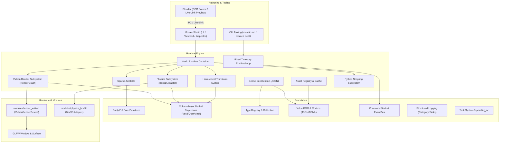
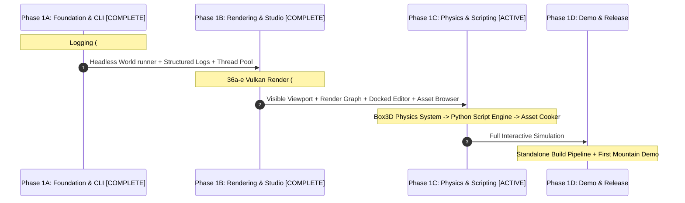

# Mosaic: Advancement Plans, Implementation Evaluation & Next Steps

**Document Version:** 1.4.0  
**Evaluation Date:** 2026-08-24  
**Evaluation Status:** Active / Updated with Studio v0.1 Lean Core (#37, PR #56, #58), Post-v0.1 Asset Browser (PR #62), and Vulkan Synchronization Hardening (PR #60, #61) Merged into `main`  
**Repository State:** Phase 0 Foundation Complete, Headless Engine Core Complete, Vulkan Rendering (#42–#46) Complete, Studio Workbench (#37) Complete (254/254 Tests Passing)  

---

## 1. Executive Summary

Mosaic is an open-source, modular 3D development platform designed with a decoupled three-tier architecture (**Foundation**, **Engine**, and **Studio**). It is engineered to provide an extensible runtime with deterministic C17 **Box3D** physics, a backend-neutral **Vulkan** renderer, an embedded **Python** scripting environment, and a first-class **Automation & Agent API** that treats humans and autonomous agents as dual clients of the same reflected command-event system.

This evaluation reviews the complete project documentation, design specifications, RFCs, and source implementations to:
1. Synthesize the latest plans for engine advancements, upgrades, and vertical milestones.
2. Evaluate the precise state of all implemented components against architectural requirements.
3. Establish a prioritized, actionable plan for completing the remaining systems required for the **v0.1 Vertical Slice**.

---

## 2. Review of Documentation & Latest Advancement Plans

A review of the architectural documentation (`docs/architecture/`), design specifications (`docs/design/`), RFCs (`docs/rfcs/`), vision documents (`docs/vision/`), and source strategy plans (`chatgpt_plans.md`, `gemini_plans.md`) reveals the following target advancements and design contracts:



### 2.1 The v0.1 Vertical Slice ("The First Mountain")
Per [`docs/project/roadmap.md`](roadmap.md), the milestone criteria for v0.1 is:
> *"A developer can create a project, bring in a Blender model, put it in a world, move it around, attach physics, write a Python script, press Play, and Build a standalone."*

### 2.2 Architectural Guardrails & Enforced Boundaries
Per [`docs/architecture/ARCHITECTURE.md`](../architecture/ARCHITECTURE.md) and [`docs/architecture/boundaries.md`](../architecture/boundaries.md):
- **Tier Isolation:** `foundation/` has zero dependencies upwards; `engine/` depends strictly on `foundation/`; `editor/`, `app/`, and `studio/` depend on `engine/` and `foundation/`.
- **The Sacred Rule:** Foundation and Engine **never** reference Blender or AI modules. Blender is an external DCC running out-of-process, interfacing only with Studio via IPC/Live-Link.
- **Boundary Abstractions:**
  - **Physics Boundary:** Public API exposes only neutral types (`PhysicsWorld`, `RigidBody`, `Collider`, `RaycastResult`); Box3D `b3*` types never leak.
  - **Render Boundary:** Public API operates over `RenderDevice`, `RenderGraph`, `Mesh`, `Material`, `Camera`, and `Light`; Vulkan/D3D12 backends live isolated under `modules/`.
  - **Automation Duality:** UI actions and AI agent instructions both serialize into identical `Command` transactions over the `EventBus` and reflected property system.

---

## 3. Evaluation of Current Implementations

### 3.1 Implemented & Validated Subsystems (Foundation, Engine Core, App Shell, Rendering & Studio)

The foundation tier, headless engine core, application shell, complete rendering subsystem, and Studio workbench are **100% complete and fully verified** by a **254-test suite** on `main` across debug and release builds:

| Component / Subsystem | Location | Architectural Role | Status / Test Coverage |
|---|---|---|:---:|
| **EntityID & Generation** | `foundation/core/entity_id.hpp` | 32-bit index / 32-bit generation handle; slot retirement on generation exhaustion. | Verified (`[ecs]`) |
| **Sparse-Set ECS** | `engine/ecs/` | `EntityRegistry` with free-list recycling; `ComponentRegistry` with dense `SparseSet` iteration; `System` virtual interface. | Verified (`[ecs]`) |
| **Foundation Math & Projections** | `foundation/math/` | Column-major `Vec3`, `Quat`, `Mat4`, TRS transformations, vector operations (`dot`, `cross`, `normalize`, `length`), Vulkan clip space projections (`Mat4::perspective`, `Mat4::look_at`), and `Mat4::inverse_affine`. | Verified (`[math]`) |
| **Type Reflection** | `foundation/reflection/` | `TypeID`, `TypeRegistry` (name/id lookup, visitor traversal), `ComponentReflection` dynamic component constructor/saver, `FieldVisitor` property visitor. | Verified (`[reflection]`) |
| **Serialization DOM** | `foundation/serialization/` | `Value` DOM, JSON/TOML codecs, depth cap guard (128) against stack overflow, `ReferenceResolver`. | Verified (`[value]`, `[json]`, `[toml]`) |
| **Commands & Events** | `foundation/commands/`, `foundation/events/` | `Command` contract, undoable `CommandStack`, double-buffered FIFO deferred `EventBus` with synchronous in-tick dispatch. | Verified (`[commands]`, `[events]`) |
| **Structured Logging** | `foundation/logging/log.hpp` | Leveled (`trace`..`fatal`), categorized logging, `ConsoleSink`, atomic filter, mutex-guarded dispatch, 8-thread stress test. | Verified (`[logging]`) |
| **Jobs & Concurrency** | `foundation/jobs/` | `ThreadPool` task submission returning `future<void>`, `parallel_for` with latch wait and exception rethrow, clean drain shutdown. | Verified (`[jobs]`) |
| **World Runtime** | `engine/world/` | Container for entities, components, and event bus; deterministic 3-stage tick (Event drain $\rightarrow$ Systems update $\rightarrow$ Deferred destruction). | Verified (`[world]`) |
| **Scene Serialization** | `engine/scene/` | Full `World` $\leftrightarrow$ JSON persistence with two-pass `EntityID` handle remapping and empty entity preservation. | Verified (`[scene]`) |
| **Asset Registry & Enumeration** | `engine/assets/` | `AssetMetadata` TOML codec, lazy cached `load<T>`, eager resource registration, `AssetReferenceResolver`, `AssetRegistry::for_each`. | Verified (`[assets]`) |
| **Transform System** | `engine/transform/` | Reflected `Transform` component, derived `WorldTransform`, hierarchical parent-child evaluation with cycle-depth guard. | Verified (`[transform]`) |
| **Runtime Loop** | `engine/runtime/` | Fixed-timestep accumulator driver, remainder banking, pause/resume, single-step, spiral-of-death clamp, 1,000-tick stability. | Verified (`[runtime]`) |
| **App / CLI Runner** | `app/` | CLI11 argument parsing (`mosaic run`, `mosaic editor`), `FramePump` with wall-clock pacing, signal handling, `JsonStatusReporter`, and `--window` mode. | Verified (`[cli]`, `[app]`) |
| **Neutral RenderDevice** | `engine/render/render_device.hpp` | Abstract device interface (`begin_frame`, `clear`, `end_frame`, `create_mesh`, `draw`, offscreen viewport hooks) isolating engine/app from graphics APIs. | Verified (`[render]`) |
| **Vulkan Bootstrap & Swapchain (36a / #42)** | `modules/render_vulkan/` | Vulkan 1.3 instance, physical device scoring, queue families, GLFW surface, swapchain recreation, frames-in-flight sync, clear-screen. | Verified (`[render]`, PR #48) |
| **Mesh Draw at Transform (36b / #43)** | `engine/render/`, `modules/render_vulkan/` | `MeshRenderer` component, `make_cube_mesh()`, `RenderSystem` traversal, SPIR-V shaders (`glslc`), depth buffer (`D32_SFLOAT`), push constant MVP, spinning cube demo. | Verified (`[render]`, PR #49) |
| **Camera & View/Projection (36c / #44)** | `engine/render/`, `foundation/math/` | Reflected `Camera` component, `Mat4::inverse_affine`, `RenderSystem` dynamic camera traversal, multi-camera priority, fallback observer camera. | Verified (`[render]`, `[reflection]`, PR #50) |
| **Materials, Textures & Lighting (36d/36e / #45, #46)** | `engine/render/`, `modules/render_vulkan/` | Reflected `Material`, `DirectionalLight`, `PointLight`, procedural texture generation, lit shader pipeline. | Verified (`[render]`, PR #53, #54) |
| **Studio Editor Shell & Workbench (37a / #37)** | `studio/` | ImGui docking shell, menu bar, status bar, dark theme styling. | Verified (`[studio]`, PR #55) |
| **Studio Hierarchy Panel (37b / #37)** | `studio/` | Live scene outliner, `SelectionModel` entity selection state. | Verified (`[studio]`, PR #55) |
| **Studio Reflection Inspector (37c / #37)** | `studio/`, `engine/reflection/` | In-place component property editing (`FieldVisitor`), vector/rotation/bool controls. | Verified (`[studio]`, `[reflection]`, PR #56) |
| **Studio Offscreen Viewport (37d / #37)** | `studio/`, `modules/render_vulkan/` | Dynamic panel sizing, offscreen Vulkan render target sampling into ImGui. | Verified (`[studio]`, `[render]`, PR #58) |
| **Studio Play/Stop & Console (37e / #37)** | `studio/` | Play/Pause/Step simulation toolbar, thread-safe `ConsoleBuffer` log capture sink. | Verified (`[studio]`, PR #58, #59) |
| **Studio Asset Browser (#37 Post-v0.1)** | `studio/`, `engine/assets/` | Asset listing, selection, and live "Assign to Selected" property assignment. | Verified (`[studio]`, `[assets]`, PR #62) |

### 3.2 Outstanding & Unimplemented Systems (The Frontier)

The following systems are documented in specifications and roadmaps and form the active implementation frontier:

```
[ Foundation Tier ]
  └── All Phase 0 Foundation systems COMPLETE (#9, #10, #11, #18, #21, #26, #33, #34) ✓

[ Application Tier ]
  ├── mosaic run standalone CLI runner + windowed demo COMPLETE (#35, #42–#46) ✓
  └── mosaic editor Studio workbench COMPLETE (#37a–#37e + Asset Browser) ✓

[ Visual & Authoring Subsystems ]
  ├── #36 Vulkan Rendering (36a–36e) ────────────────────────────────── [COMPLETE - PR #48–#54] ✓
  ├── #37 Studio Workbench (37a–37e + Asset Browser) ────────────────── [COMPLETE - PR #55–#62] ✓
  ├── Box3D Physics Adapter (RigidBody, Colliders, PhysicsSystem) ───── [NEXT BUILDABLE]
  ├── Python Scripting (Embedding, Reflection Bindings) ──────────────── [UNBUILT]
  └── Blender Asset Importer & Live-Link Preview ─────────────────────── [UNBUILT]
```

### 3.3 Technical Debt & Refinement Backlog
1. **Issue #25 — Component TypeID Densification:** `foundation::reflection::type_id<T>()` allocates from a single global counter across all reflected types. Consequently, `ComponentRegistry::storages_` allocates null vector slots for non-component types. While correctness-safe for v0.1, it should be upgraded to a dense component index or hash lookup post-v0.1.
2. **Scene $\leftrightarrow$ Asset Registry Integration:** Scene loading currently remaps entity handles; wiring `AssetReferenceResolver` directly into the scene loader will validate external asset references during scene deserialization.
3. **Transform Hierarchy Evaluation Optimization:** `TransformSystem::update` currently evaluates ancestor chains per entity. For large scenes, topological ordering or per-tick evaluation caching should be introduced.

---

## 4. Comprehensive Advancement Plan & Implementation Roadmap

To transition Mosaic from its current operational Studio state into a complete v0.1 vertical slice, work is organized into four sequential phases:



### Phase 1A: Runnable CLI Shell & Foundation Completion [COMPLETE]
*Goal: Stand up the process `main`, wall-clock frame pump, structured logging, and concurrency primitives.*
1. **Step 1 — Structured Logging Subsystem ([Issue #33](https://github.com/Evol-Luci/mosaic/issues/33)) — COMPLETE (PR #39)**
2. **Step 2 — App / CLI Shell ([Issue #35](https://github.com/Evol-Luci/mosaic/issues/35)) — COMPLETE (PR #40)**
3. **Step 3 — Foundation Job System ([Issue #34](https://github.com/Evol-Luci/mosaic/issues/34)) — COMPLETE (PR #41)**

---

### Phase 1B: First Visible Subsystem (Rendering & Studio Viewport) [COMPLETE]
*Goal: Render 3D geometry on GPU, bind dynamic cameras, apply lighting and materials, and inspect reflected entity components in Studio.*

4. **Step 4 — Vulkan Rendering Subsystem ([Issue #36](https://github.com/Evol-Luci/mosaic/issues/36), Decomposed into [#42](https://github.com/Evol-Luci/mosaic/issues/42)–[#46](https://github.com/Evol-Luci/mosaic/issues/46)) — COMPLETE (PR #48–#54):**
   - **Step 4.1 ([#42](https://github.com/Evol-Luci/mosaic/issues/42) — 36a) — COMPLETE (PR #48):** `RenderDevice` neutral interface + GLFW windowing + Vulkan instance/device bootstrap + Swapchain clear-screen in `FramePump`.
   - **Step 4.2 ([#43](https://github.com/Evol-Luci/mosaic/issues/43) — 36b) — COMPLETE (PR #49):** Vertex & Index Buffers + GPU staging transfers + Mesh draw at `WorldTransform` + SPIR-V shaders + Depth buffer + spinning cube demo.
   - **Step 4.3 ([#44](https://github.com/Evol-Luci/mosaic/issues/44) — 36c) — COMPLETE (PR #50):** Camera Component (`fov`, `near`, `far`, `is_active`) + `Mat4::inverse_affine` + View/Projection matrices dynamically evaluated from active camera's `WorldTransform`.
   - **Step 4.4 ([#45](https://github.com/Evol-Luci/mosaic/issues/45) — 36d) — COMPLETE (PR #53):** Material + Texture samplers (descriptor sets) + Directional Light shading + procedural textures.
   - **Step 4.5 ([#46](https://github.com/Evol-Luci/mosaic/issues/46) — 36e) — COMPLETE (PR #54):** Point Lights + multi-light attenuation.
5. **Step 5 — Studio Shell & Reflection Inspector ([Issue #37](https://github.com/Evol-Luci/mosaic/issues/37)) — COMPLETE (PR #55–#62):**
   - **37a (Shell):** ImGui docking shell, menu bar, status bar.
   - **37b (Hierarchy):** Entity outliner with selection model.
   - **37c (Inspector):** Live reflection inspector with in-place component property editing.
   - **37d (Viewport):** Dynamic offscreen Vulkan viewport render pass sampled into ImGui.
   - **37e (Controls & Console):** Play/Pause/Step simulation toolbar + thread-safe console log sink.
   - **Asset Browser:** Asset listing, selection, and live "Assign to Selected" property mutation.

---

### Phase 1C: Interactive Simulation, Scripting & Pipeline [ACTIVE FRONTIER]
*Goal: Integrate physics simulation and Python gameplay authoring.*

6. **Step 6 — Box3D Physics Integration (NEXT BUILDABLE):**
   - Implement `engine/physics/physics_backend.hpp` interface.
   - Build Box3D adapter (`modules/physics_box3d/`) mapping neutral types (`RigidBody`, `BoxCollider`, `SphereCollider`, `CapsuleCollider`, `HullCollider`).
   - Implement `engine/physics/physics_system.hpp`: Synchronize `Transform` $\leftrightarrow$ Box3D body state with fixed-substep simulation and raycast query dispatch.
7. **Step 7 — Python Scripting Runtime:**
   - Embed Python C-API / pybind11 in `engine/scripting/`.
   - Auto-generate Python module bindings from `TypeRegistry`.
   - Implement `ScriptComponent` and `ScriptSystem` invoking `on_start`, `on_update(dt)`, `on_destroy`.
8. **Step 8 — Asset Compiler & Blender Pipeline:**
   - Implement Asset Importer / Cooker (`tools/cooker/`): Convert source formats (`.blend`, `.gltf`, `.obj`) to Mosaic runtime Mesh/Material binary resources.
   - Implement Blender Add-on Live-Link for viewport transform preview.

---

### Phase 1D: Standalone Packaging & First Mountain Demo
*Goal: Deliver the end-to-end v0.1 milestone.*

9. **Step 9 — Standalone Build Pipeline (`mosaic build`):**
   - Pack cooked scene graphs, assets, and engine binaries into standalone platform executables (`MyGame.exe` / `MyGame-linux`).
10. **Step 10 — Verify First Mountain Milestone Demo:**
    - Execute workflow: `mosaic create demo` $\rightarrow$ Import model $\rightarrow$ Add Transform/Physics $\rightarrow$ Attach Python script $\rightarrow$ Run in Studio $\rightarrow$ Build Standalone.

---

## 5. Summary of Immediate Execution Targets

| Order | Task / Issue | Target Output | Status / Next Step |
|:---:|---|---|---|
| ~~1~~ | ~~Logging Subsystem (#33)~~ | `foundation/logging/`, sinks, tests | **COMPLETE (PR #39)** |
| ~~2~~ | ~~App / CLI Runner (#35)~~ | `mosaic run`, process `main`, frame pump | **COMPLETE (PR #40)** |
| ~~3~~ | ~~Job System (#34)~~ | Thread pool, `parallel_for` | **COMPLETE (PR #41)** |
| ~~4~~ | ~~Vulkan Bootstrap & Clear (#42 / 36a)~~ | `RenderDevice`, GLFW, Vulkan clear-screen | **COMPLETE (PR #48)** |
| ~~5~~ | ~~Mesh Draw at Transform (#43 / 36b)~~ | Vertex/Index buffers, GPU staging, draw calls, cube demo | **COMPLETE (PR #49)** |
| ~~6~~ | ~~Camera & Projection (#44 / 36c)~~ | Camera component, dynamic View/Proj matrices from camera entity | **COMPLETE (PR #50)** |
| ~~7~~ | ~~Materials & Lighting (#45 / 36d)~~ | Texture descriptors, Directional light shading, asset loading | **COMPLETE (PR #53)** |
| ~~8~~ | ~~Point Lights & Lighting (#46 / 36e)~~ | Point light attenuation, multi-light shaders | **COMPLETE (PR #54)** |
| ~~9~~ | ~~Studio Shell & Inspector (#37)~~ | ImGui viewport, hierarchy, reflection property inspector, play/stop, console, asset browser | **COMPLETE (PR #55–#62)** |
| **10** | **Box3D Physics Integration** | `PhysicsWorld`, `RigidBody`, `BoxCollider`, `PhysicsSystem` | **NEXT BUILDABLE** |
| **11** | **Python Scripting Runtime** | Embedded Python, reflected bindings, `ScriptSystem` | Blocked on Physics |
| **12** | **Blender Live-Link Preview** | Blender add-on socket bridge to Studio | In Backlog |

---

## 6. Traceability & Filing Notice

This evaluation is permanently filed in the Mosaic repository documentation hub:
- **File Location:** [`docs/project/advancement-plans-and-evaluation.md`](file:///home/lucievol/Projects/mosaic/docs/project/advancement-plans-and-evaluation.md)
- **Documentation Hub Link:** Registered in [`docs/index.html`](file:///home/lucievol/Projects/mosaic/docs/index.html) under *General* and *Project & Legal*.
- **Related Tracking Issues:** GitHub Issues [#33](https://github.com/Evol-Luci/mosaic/issues/33), [#34](https://github.com/Evol-Luci/mosaic/issues/34), [#35](https://github.com/Evol-Luci/mosaic/issues/35), [#36](https://github.com/Evol-Luci/mosaic/issues/36), [#42](https://github.com/Evol-Luci/mosaic/issues/42), [#43](https://github.com/Evol-Luci/mosaic/issues/43), [#44](https://github.com/Evol-Luci/mosaic/issues/44), [#45](https://github.com/Evol-Luci/mosaic/issues/45), [#46](https://github.com/Evol-Luci/mosaic/issues/46), [#37](https://github.com/Evol-Luci/mosaic/issues/37), [#25](https://github.com/Evol-Luci/mosaic/issues/25).
- **Rule of Re-Evaluation:** *If no further architectural or implementation changes have been made to the repository since the timestamp on this document, no new evaluation is required.*
