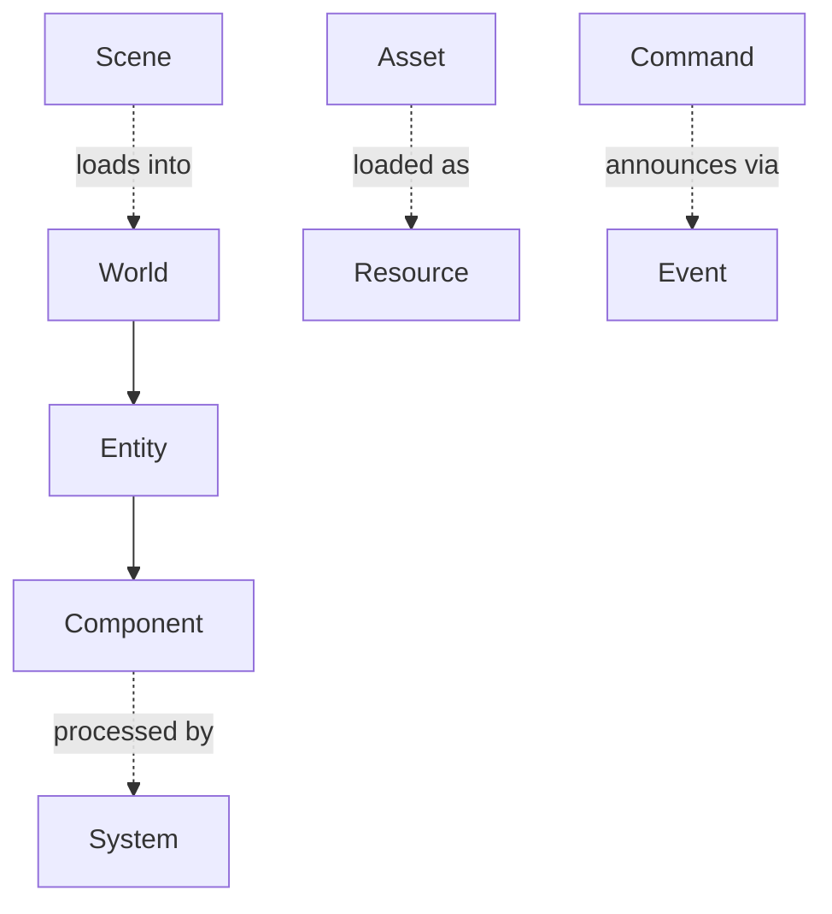

# RFC 0001: Core Data Model

- **Status:** Accepted
- **Author:** The Mosaic Project
- **Date:** 2026-08-15
- **Accepted:** 2026-08-15
- **Supersedes:** none

## Summary

Formalize Mosaic's core data primitives — `Entity`, `Component`, `System`,
`World`, `Scene`, `Asset`, `Resource`, `Command`, `Event`, `Module`, `Plugin`,
`Property`, `Reference` — with exact definitions and serialization stances, so the
rest of the engine can grow around a stable foundation. This RFC turns the
narrative [data model](../architecture/data-model.md) into a set of decisions
implementers can build against.

## Motivation

The data model is the one part of the system that is expensive to change later:
serialization, tooling, scripting, and networking all depend on it. Nailing it
down first is what lets the foundation stop needing a rewrite every six months. It
is the first thing a contributor to the v0.1 slice must build.

## Guide-level explanation

An **Entity** is only an identity (`EntityID`). Data lives in **Components**
attached to entities. Behavior lives in **Systems** that process components each
tick. A **World** is the runtime container holding entities, components, and the
active systems. A **Scene** is an *asset* that serializes a set of
entities/components; loading a scene into a world instantiates them.

Content is addressed as **Assets** (UUID + metadata + dependencies); their loaded
runtime form is a **Resource**. Mutations happen through **Commands** (undoable,
serializable); state changes are announced by **Events**. Capability is packaged as
**Modules** (built-in) and **Plugins** (third-party). **Properties** are reflected
fields; **References** are typed UUID links resolved at load.

## Reference-level explanation

### Identity types

- `EntityID` — opaque, stable within a World; a **64-bit generational index**
  split **32 bits index / 32 bits generation** (index in the low half). The index
  addresses a slot in the entity storage; the generation is bumped each time a
  slot is recycled, so a handle to a freed entity is detectable (its generation no
  longer matches the slot). This allows up to 4,294,967,296 (2³²) live entities and
  the same number of reuses per slot. On generation exhaustion — practically
  unreachable at 32 bits — the slot is **retired** (never recycled again) rather
  than wrapped, so generational checks can never alias. `EntityID(0)` is reserved
  as the null/invalid handle.
- `AssetID` — a UUID (128-bit), globally stable, used for all cross-references.
- `TypeID`, `ModuleID`, `CommandID` — stable identifiers derived from reflection
  registration.

### Component contract

- Components are plain data; no virtual behavior.
- All fields are reflected (see [reflection](../design/reflection.md)); reflection
  metadata is the single source for serialization, inspector, bindings, and
  animation.
- Components are serialized by field, not by hand-written serializers.

### System contract

- A system declares the components it reads/writes; scheduling and threading are a
  later concern (job system), but the *declaration* is part of the model now.
- Systems hold no per-entity state; state lives in components.

### Scene vs World

- **Scene = asset.** Serialized, versioned, references assets by `AssetID`.
- **World = runtime.** Not directly serialized; it loads scenes and holds live
  state. Save-state is a separate future concern, out of scope here.

### Asset & Resource

- Asset metadata fields (normative): `uuid, type, version, source, dependencies,
  metadata, import_settings`.
- Resource is the loaded instance produced by the
  [asset pipeline](../design/asset-pipeline.md); not serialized directly.
- The v0.1 public API exposes an explicit, typed **`Handle<T>`** to a Resource.
  Handles are how scripts, agents, and components hold a loaded Resource without
  owning its storage. A handle is a lightweight value (an index into the asset
  server's resource table, plus a generation), not a raw pointer.
  - **Strong** handles keep the Resource alive; the asset server **refcounts**
    strong handles and may unload a Resource once its strong count reaches zero.
  - **Weak** handles observe without extending lifetime; dereferencing a weak
    handle to an unloaded Resource yields null, not undefined behavior.
  - Handles serialize as the underlying `AssetID` (see serialization stance) and
    are re-resolved to a live Resource at load; the runtime table index is never
    serialized.

### Command & Event

- Command fields (normative): `id, parameters, required_permissions, execute(),
  undo(), serialize()`.
- Commands are the transaction log and the automation surface.
- Events are immutable payloads. **Synchronous** delivery is the default: the
  event is dispatched to synchronous subscribers immediately, in-tick, on the
  emitting thread, before `emit` returns.
- A subscriber may opt into **deferred** delivery. Deferred events use a
  **double-buffered queue**: emits during a tick are appended to a write buffer;
  at a fixed sync point at the start of the next tick the buffers are swapped and
  the read buffer is **drained in full** to deferred subscribers, then cleared.
  - **Ordering:** deferred events are delivered **FIFO** in emit order. A deferred
    subscriber therefore always observes events one tick after emission, never
    mid-tick, which removes reentrancy hazards for handlers that mutate the World.
  - Synchronous and deferred subscribers to the same event type are independent:
    the synchronous ones fire in-tick; the deferred ones fire on the next drain.
  - **Relation to Commands:** the [command](../design/command-event-system.md)
    transaction log is the source of truth for undoable mutations; Events only
    *announce* state changes and are **not** replayed from the log. A deferred
    Event emitted by a Command is enqueued when the Command executes, not when it
    is undone/redone.

### Serialization stance

- The **schema is normative; the concrete syntax is not** — any conforming loader
  may accept alternative encodings of the same schema. The v0.1 reference tooling
  uses two human-readable syntaxes, chosen per role:
  - **TOML** for human-authored, mostly-flat metadata: asset metadata, project and
    world config, import settings. Diff-friendly, commentable, ergonomic to hand-edit.
  - **JSON** for **scenes** and other deeply-nested, predominantly tool-generated
    graphs (arrays of entities, each with a map of components with nested fields),
    where TOML's arrays-of-tables become unwieldy. JSON round-trips the reflected
    schema directly and is cheap to emit/parse in the content compilers.
- Both are lossless projections of the same reflected schema; a value authored in
  one can be re-emitted in the other without semantic change.
- Binary runtime resources for cooked data.
- `References` serialize as `AssetID`/`EntityID` and resolve at load.

## Drawbacks

- Committing to reflected-by-default components requires the reflection system to
  land early, front-loading effort.
- Generational `EntityID`s add a small amount of per-access validation cost.

## Rationale & alternatives

- **Copying Blender's data model** was rejected: it is authoring-centric, not a
  runtime ECS.
- **Copying Unreal's `Actor/Component/UObject`** was rejected: heavier than needed
  and couples identity to object.
- Entity-as-identity + reflected components is the smallest model that yields
  serialization, tooling, scripting, and automation from one source.

## Resolved decisions

The four questions that gated acceptance are now settled (resolved 2026-08-15):

- **`EntityID` bit layout** ([#1]) — 64-bit, **32 index / 32 generation**, slot
  retired on generation exhaustion. See [Identity types](#identity-types).
- **On-disk metadata syntax** ([#2]) — **TOML** for config/asset metadata, **JSON**
  for nested scenes; schema remains normative. See [Serialization stance](#serialization-stance).
- **Event deferral semantics** ([#3]) — **double-buffered, per-frame drain**, FIFO
  deferred delivery; synchronous handlers still fire in-tick. See [Command & Event](#command--event).
- **`Resource` public handle** ([#4]) — yes, a typed refcounted **`Handle<T>`**
  (strong/weak) in the v0.1 API. See [Asset & Resource](#asset--resource).

[#1]: https://github.com/Evol-Luci/mosaic/issues/1
[#2]: https://github.com/Evol-Luci/mosaic/issues/2
[#3]: https://github.com/Evol-Luci/mosaic/issues/3
[#4]: https://github.com/Evol-Luci/mosaic/issues/4

## Follow-up work

Acceptance opens implementation of the foundation slice against this model:
the ECS (EntityID + generational storage), serialization (TOML/JSON reflection
round-trip), and the command/event system. See the issues linked from the
[tracking issue](https://github.com/Evol-Luci/mosaic/issues/5).
