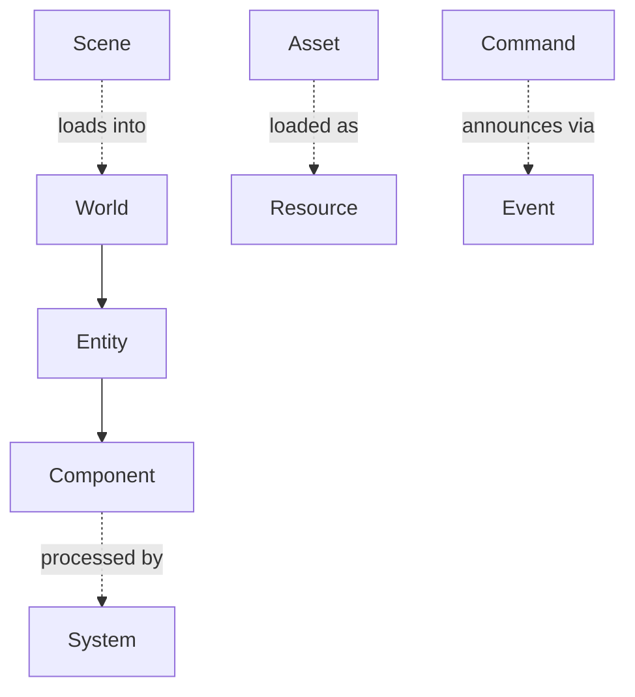

# RFC 0001: Core Data Model

- **Status:** Draft
- **Author:** The Mosaic Project
- **Date:** 2026-08-15
- **Supersedes:** none

## Summary

Formalize Mosaic's core data primitives — `Entity`, `Component`, `System`,
`World`, `Scene`, `Asset`, `Resource`, `Command`, `Event`, `Module`, `Plugin`,
`Property`, `Reference` — with exact definitions and serialization stances, so the
rest of the engine can grow around a stable foundation. This RFC turns the
narrative [data model](../architecture/data-model.md) into a set of decisions
implementers can build against.

## Motivation

The data model is the one part of the system that is expensive to change later:
serialization, tooling, scripting, and networking all depend on it. Nailing it
down first is what lets the foundation stop needing a rewrite every six months. It
is the first thing a contributor to the v0.1 slice must build.

## Guide-level explanation

An **Entity** is only an identity (`EntityID`). Data lives in **Components**
attached to entities. Behavior lives in **Systems** that process components each
tick. A **World** is the runtime container holding entities, components, and the
active systems. A **Scene** is an *asset* that serializes a set of
entities/components; loading a scene into a world instantiates them.

Content is addressed as **Assets** (UUID + metadata + dependencies); their loaded
runtime form is a **Resource**. Mutations happen through **Commands** (undoable,
serializable); state changes are announced by **Events**. Capability is packaged as
**Modules** (built-in) and **Plugins** (third-party). **Properties** are reflected
fields; **References** are typed UUID links resolved at load.

## Reference-level explanation

### Identity types

- `EntityID` — opaque, stable within a World; proposed as a 64-bit
  generational index (index + generation) to make stale references detectable.
- `AssetID` — a UUID (128-bit), globally stable, used for all cross-references.
- `TypeID`, `ModuleID`, `CommandID` — stable identifiers derived from reflection
  registration.

### Component contract

- Components are plain data; no virtual behavior.
- All fields are reflected (see [reflection](../design/reflection.md)); reflection
  metadata is the single source for serialization, inspector, bindings, and
  animation.
- Components are serialized by field, not by hand-written serializers.

### System contract

- A system declares the components it reads/writes; scheduling and threading are a
  later concern (job system), but the *declaration* is part of the model now.
- Systems hold no per-entity state; state lives in components.

### Scene vs World

- **Scene = asset.** Serialized, versioned, references assets by `AssetID`.
- **World = runtime.** Not directly serialized; it loads scenes and holds live
  state. Save-state is a separate future concern, out of scope here.

### Asset & Resource

- Asset metadata fields (normative): `uuid, type, version, source, dependencies,
  metadata, import_settings`.
- Resource is the loaded instance produced by the
  [asset pipeline](../design/asset-pipeline.md); not serialized directly.

### Command & Event

- Command fields (normative): `id, parameters, required_permissions, execute(),
  undo(), serialize()`.
- Commands are the transaction log and the automation surface.
- Events are immutable payloads; delivery is synchronous within a tick unless a
  subscriber opts into deferral (deferral mechanics: out of scope for this RFC).

### Serialization stance

- Human-readable metadata format for scenes/assets/project config (exact syntax —
  JSON/TOML/YAML — deferred; **schema is normative, syntax is not**).
- Binary runtime resources for cooked data.
- `References` serialize as `AssetID`/`EntityID` and resolve at load.

## Drawbacks

- Committing to reflected-by-default components requires the reflection system to
  land early, front-loading effort.
- Generational `EntityID`s add a small amount of per-access validation cost.

## Rationale & alternatives

- **Copying Blender's data model** was rejected: it is authoring-centric, not a
  runtime ECS.
- **Copying Unreal's `Actor/Component/UObject`** was rejected: heavier than needed
  and couples identity to object.
- Entity-as-identity + reflected components is the smallest model that yields
  serialization, tooling, scripting, and automation from one source.

## Unresolved questions

- Exact `EntityID` bit layout (index/generation split).
- The on-disk metadata syntax (deferred until serialization is prototyped).
- Event deferral/queuing semantics.
- Whether `Resource` needs an explicit public handle type in the v0.1 API.
