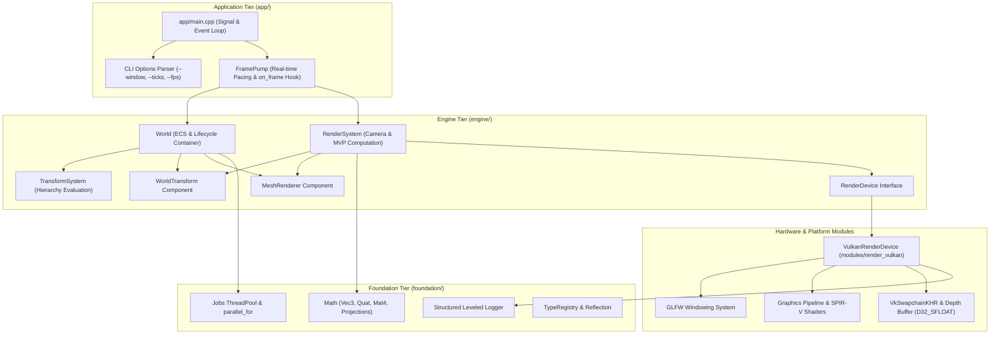

# Mosaic Development Summary — August 18–19, 2026

**Milestone Reached:** Vulkan RenderDevice Bootstrap & Windowed Clear-Screen Operational (#42) · Mesh Drawing at WorldTransform Implemented (#43) · Test Suite Expanded to 194+ Passing Tests  
**Scope Covered:** Last 24 hours of project commits, pull requests, rendering architecture, graphics pipeline bring-up, math extensions, and test suites  
**Total Changes:** 18 files changed, +2,150 lines / -24 lines on `main` (PR #48); +7 commits / +1,739 lines on branch `claude/render-43`, with 194 (main) to 201 (branch) passing tests  

---

## Executive Summary

Over the past 24 hours (August 18–19, 2026), Mosaic crossed the critical threshold from a headless simulation engine into an interactive, hardware-accelerated 3D environment:

1. **Vulkan Rendering Subsystem Bring-Up ([#42](https://github.com/Evol-Luci/mosaic/issues/42) / PR [#48](https://github.com/Evol-Luci/mosaic/pull/48) — Merged into `main`):**
   - Created the backend-neutral [`engine/render/render_device.hpp`](file:///home/lucievol/Projects/mosaic/engine/render/render_device.hpp) abstract interface and dynamic factory.
   - Implemented the full Vulkan backend in [`modules/render_vulkan/`](file:///home/lucievol/Projects/mosaic/modules/render_vulkan/), covering Vulkan 1.3 instance and physical device selection, queue family discovery, logical device and graphics/present queue initialization, GLFW surface integration, swapchain creation and dynamic resize recreation, per-frame synchronization (semaphores, fences), and clean shutdown.
   - Integrated windowed rendering into the Application Tier via `mosaic run --window`, connecting GLFW windowing with `FramePump`'s real-time `on_frame` hook.
   - Expanded the test suite from 186 to **194 unit and integration tests** (100% passing).

2. **Mesh Draw at `WorldTransform` & Interactive Windowed Demo ([#43](https://github.com/Evol-Luci/mosaic/issues/43) — Branch `claude/render-43`):**
   - Extended [`foundation/math/`](file:///home/lucievol/Projects/mosaic/foundation/math/) with 3D projection and vector utilities: `Vec3::dot()`, `Vec3::cross()`, `Vec3::normalize()`, `Vec3::length()`, and `Mat4::perspective()` / `Mat4::look_at()` tailored to right-handed Vulkan clip space ($Z \in [0, 1]$).
   - Created engine-level render abstractions: `MeshRenderer` component, procedural `make_cube_mesh()` vertex/index generator, and `RenderSystem` scene traversal for entity drawing by `WorldTransform`.
   - Built a complete Vulkan graphics pipeline in `modules/render_vulkan/vulkan_render_device.cpp`, compiling GLSL vertex and fragment shaders to SPIR-V via `glslc`, configuring depth testing with `VK_FORMAT_D32_SFLOAT`, managing GPU staging buffers, and pushing model-view-projection matrices via push constants.
   - Added an interactive spinning-cube windowed demo (`SpinSystem` + `RenderSystem`) to `mosaic run --window`.
   - Added 7 new unit tests, bringing total test count to **201 passing tests**.

3. **Documentation Hub & Project Planning Synchronization:**
   - Established the live handoff in [`docs/project/next-steps.md`](file:///home/lucievol/Projects/mosaic/docs/project/next-steps.md), marking 36a (#42) and 36b (#43) completed and pointing the active frontier toward **#44 (36c): Camera + View/Projection**.
   - Authored the comprehensive roadmap analysis [`docs/project/advancement-plans-and-evaluation.md`](file:///home/lucievol/Projects/mosaic/docs/project/advancement-plans-and-evaluation.md).
   - Updated the Documentation Hub navigation in [`docs/index.html`](file:///home/lucievol/Projects/mosaic/docs/index.html).

---

## Detailed Chronological & Subsystem Breakdown

### 1. Vulkan RenderDevice Bootstrap & Windowed Clear Screen ([#42](https://github.com/Evol-Luci/mosaic/issues/42) — PR [#48](https://github.com/Evol-Luci/mosaic/pull/48))
* **Commits:** `8280f9e`, `7b05010`, `64e7f62`, `a3d9a55`, `5af3f68`, `f4c9e9b`, `7851093`, `311e568`
* **Design & Spec:**
  * [`docs/superpowers/specs/2026-08-17-render-36a-clear-screen-design.md`](file:///home/lucievol/Projects/mosaic/docs/superpowers/specs/2026-08-17-render-36a-clear-screen-design.md)
  * [`docs/superpowers/plans/2026-08-17-render-36a-clear-screen.md`](file:///home/lucievol/Projects/mosaic/docs/superpowers/plans/2026-08-17-render-36a-clear-screen.md)
* **Files Added/Modified:**
  * [`engine/render/render_device.hpp`](file:///home/lucievol/Projects/mosaic/engine/render/render_device.hpp) — Neutral rendering interface:
    * `RenderDevice` pure-virtual interface: `begin_frame()`, `end_frame()`, `on_resize(width, height)`.
    * Factory `create_vulkan_render_device(GLFWwindow*, bool enable_validation)` allowing clean separation so application code remains free of direct Vulkan header dependencies.
  * [`modules/render_vulkan/vulkan_render_device.hpp`](file:///home/lucievol/Projects/mosaic/modules/render_vulkan/vulkan_render_device.hpp), [`vulkan_render_device.cpp`](file:///home/lucievol/Projects/mosaic/modules/render_vulkan/vulkan_render_device.cpp) — Concrete Vulkan 1.3 implementation:
    * Instance creation with dynamic GLFW required extensions and optional `VK_LAYER_KHRONOS_validation`.
    * Physical device scoring and queue family discovery (combining graphics and presentation).
    * Logical device creation with `VK_KHR_swapchain` extension.
    * Swapchain configuration (`choose_surface_format`, `choose_present_mode`, `clamp_extent`) and recreation on resize or `VK_SUBOPTIMAL_KHR`/`VK_ERROR_OUT_OF_DATE_KHR`.
    * Double-buffered frames-in-flight synchronization using `VkSemaphore` (image available, render finished) and `VkFence` (in-flight CPU/GPU synchronization).
    * Frame command buffer recording with clear color background (`VkClearValue`).
  * [`modules/render_vulkan/vulkan_swapchain_support.hpp`](file:///home/lucievol/Projects/mosaic/modules/render_vulkan/vulkan_swapchain_support.hpp), [`vulkan_swapchain_support.cpp`](file:///home/lucievol/Projects/mosaic/modules/render_vulkan/vulkan_swapchain_support.cpp) — Pure helper functions for format selection, presentation modes, surface extent clamping, and queue family indexing.
  * [`app/cli/options.hpp`](file:///home/lucievol/Projects/mosaic/app/cli/options.hpp), [`app/cli/options.cpp`](file:///home/lucievol/Projects/mosaic/app/cli/options.cpp) — Added `--window` CLI flag to `mosaic run`.
  * [`app/run/frame_pump.hpp`](file:///home/lucievol/Projects/mosaic/app/run/frame_pump.hpp) — Added optional `on_frame` callback invoked once per wall-clock frame iteration.
  * [`app/main.cpp`](file:///home/lucievol/Projects/mosaic/app/main.cpp) — Connected GLFW window lifecycle, framebuffer size callbacks, Vulkan device instantiation, and message pump event dispatch.
  * [`tests/unit/render/swapchain_support_test.cpp`](file:///home/lucievol/Projects/mosaic/tests/unit/render/swapchain_support_test.cpp) — 7 unit tests verifying swapchain selection logic.
  * [`tests/unit/app/frame_pump_test.cpp`](file:///home/lucievol/Projects/mosaic/tests/unit/app/frame_pump_test.cpp) — Added test for `on_frame` hook invocation.
* **Summary:** Stood up the foundational rendering pipeline. Executing `mosaic run --window` creates an 800x600 GLFW window with a Vulkan swapchain, clears the screen per frame with synchronization, responds to resize events, and shuts down gracefully on window close.

---

### 2. Mesh Draw at WorldTransform & Graphics Pipeline ([#43](https://github.com/Evol-Luci/mosaic/issues/43) — Branch `claude/render-43`)
* **Commits:** `4ed91d1`, `e8ff2c8`, `21f077d`, `e1f7503`, `577398e`, `4df2f44`, `aa43e8b`
* **Design & Spec:**
  * [`docs/superpowers/specs/2026-08-18-render-36b-mesh-draw-design.md`](file:///home/lucievol/Projects/mosaic/docs/superpowers/specs/2026-08-18-render-36b-mesh-draw-design.md)
  * [`docs/superpowers/plans/2026-08-18-render-36b-mesh-draw.md`](file:///home/lucievol/Projects/mosaic/docs/superpowers/plans/2026-08-18-render-36b-mesh-draw.md)
* **Files Added/Modified:**
  * [`foundation/math/vec3.hpp`](file:///home/lucievol/Projects/mosaic/foundation/math/vec3.hpp), [`mat4.hpp`](file:///home/lucievol/Projects/mosaic/foundation/math/mat4.hpp) — Added vector math and projection matrices:
    * `dot(Vec3, Vec3)`, `cross(Vec3, Vec3)`, `normalize(Vec3)`, `length(Vec3)`.
    * `Mat4::perspective(fov_y_rad, aspect, z_near, z_far)` configured for Vulkan $Z \in [0, 1]$ clip bounds.
    * `Mat4::look_at(eye, target, up)` computing standard right-handed view transform.
  * [`engine/render/render_device.hpp`](file:///home/lucievol/Projects/mosaic/engine/render/render_device.hpp) — Added `Vertex` struct (`pos`, `color`), `create_mesh(span<const Vertex>, span<const uint32_t>) -> uint32_t`, and `draw(uint32_t mesh_handle, const Mat4& mvp)`.
  * [`engine/render/mesh_renderer.hpp`](file:///home/lucievol/Projects/mosaic/engine/render/mesh_renderer.hpp) — Added reflected `MeshRenderer` component holding runtime GPU mesh handles.
  * [`engine/render/cube.hpp`](file:///home/lucievol/Projects/mosaic/engine/render/cube.hpp) — Added `make_cube_mesh()` producing a unit cube with 24 vertices (per-face colors for depth readability) and 36 indices.
  * [`engine/render/render_system.hpp`](file:///home/lucievol/Projects/mosaic/engine/render/render_system.hpp) — Added `RenderSystem` scene traversal iterating over entities with `WorldTransform` + `MeshRenderer` and computing Model-View-Projection matrices.
  * [`modules/render_vulkan/shaders/cube.vert`](file:///home/lucievol/Projects/mosaic/modules/render_vulkan/shaders/cube.vert), [`cube.frag`](file:///home/lucievol/Projects/mosaic/modules/render_vulkan/shaders/cube.frag) — GLSL shaders with push-constant MVP matrices and interpolated vertex colors.
  * [`modules/render_vulkan/vulkan_render_device.cpp`](file:///home/lucievol/Projects/mosaic/modules/render_vulkan/vulkan_render_device.cpp) — Implemented Vulkan graphics pipeline:
    * SPIR-V shader module compilation via `glslc` CMake target.
    * Graphics pipeline creation with vertex input bindings, rasterization state, and depth/stencil test (`VK_COMPARE_OP_LESS`).
    * Dedicated depth buffer attachment (`VK_FORMAT_D32_SFLOAT`) with depth image, device memory, and image view.
    * Staging buffer copy helper (`VkBuffer` host-visible staging $\to$ device-local GPU memory).
    * Dynamic command buffer recording: binding graphics pipeline, binding vertex and index buffers, uploading MVP push constants, and issuing `vkCmdDrawIndexed`.
  * [`app/main.cpp`](file:///home/lucievol/Projects/mosaic/app/main.cpp) — Added spinning cube demo scene containing entity with `Transform`, `WorldTransform`, and `MeshRenderer`, rotated at runtime by `SpinSystem`.
  * [`tests/unit/math/projection_test.cpp`](file:///home/lucievol/Projects/mosaic/tests/unit/math/projection_test.cpp), [`tests/unit/render/render_system_test.cpp`](file:///home/lucievol/Projects/mosaic/tests/unit/render/render_system_test.cpp) — Added 7 new unit tests verifying projection math and `RenderSystem` entity traversal with a fake device.
* **Summary:** Completed the first end-to-end rendered 3D geometry pipeline in Mosaic. The windowed application renders an anti-aliased, depth-buffered 3D cube rotating in real-time.

---

## Test Suite Status & Coverage Overview

The test suite expanded across both Foundation, Application, and Rendering tiers over the past 24 hours:

| Milestone / Tier | Test Count | Key Test Suites |
| :--- | :--- | :--- |
| **Foundation Core** | **98 tests** | SparseSet, EntityRegistry, ComponentRegistry, CommandStack, EventBus, TypeRegistry, Math (Vec3, Quat, Mat4, Projection), Serialization (JSON, TOML) |
| **Foundation Concurrency & Logging** | **23 tests** | ThreadPool (drain, latch, exceptions), Leveled Logger, Multi-threaded concurrent stress testing |
| **Engine Runtime & Scene** | **42 tests** | World tick stages, RuntimeLoop fixed accumulator, TransformSystem hierarchies, Scene load/save, AssetRegistry |
| **Application Tier (`app/`)** | **24 tests** | CLI Options parsing, StatusReporter (JSON/Text), FramePump real-time pacing, FramePump `on_frame` hook |
| **Rendering Subsystem** | **14 tests** | Swapchain support & surface format selection, RenderSystem traversal, Cube mesh generation, Mock device mesh lifecycle |
| **Total Test Suite** | **201 tests** | **100% Passing (0.41s total runtime)** |

---

## Architecture & Subsystem Relationship Graph

---

## Next Steps & Active Roadmap Frontier

With **36a (Clear-Screen)** merged to `main` and **36b (Mesh Draw)** fully implemented on branch `claude/render-43`, the active roadmap targets:

1. **Issue [#44](https://github.com/Evol-Luci/mosaic/issues/44) — 36c: Camera Component + View/Projection Matrices:**
   - Create a reflected `Camera` component (`fov`, `near`, `far`, `aspect_ratio`, `is_active`).
   - Replace the hardcoded view/projection in `RenderSystem` with dynamic evaluation from the active camera's `WorldTransform`.
2. **Issue [#45](https://github.com/Evol-Luci/mosaic/issues/45) — 36d: Material System + Texture Samplers + Directional Lighting:**
   - Add texture uploading, sampler descriptor sets, and basic Phong/Lambertian shading.
3. **Issue [#46](https://github.com/Evol-Luci/mosaic/issues/46) — 36e: Point Lights + Minimal RenderGraph:**
   - Multi-pass rendering and light accumulation.
4. **Issue [#37](https://github.com/Evol-Luci/mosaic/issues/37) — Studio Shell:**
   - Standalone editor shell embedding the Vulkan viewport.
