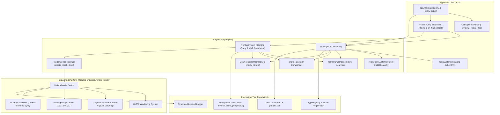

# Mosaic Development Summary — August 21–22, 2026

**Milestone Reached:** Mesh Drawing at WorldTransform (#43 / PR #49) Merged · Camera Component & Dynamic View/Projection Derivation (#44 / PR #50) Merged · Test Suite Expanded to 207 Passing Tests  
**Scope Covered:** Last 24 hours of project commits, pull requests, rendering architecture, camera systems, affine math optimizations, and test suites  
**Total Changes:** 23 files changed, +3,166 lines / -50 lines across `main` (PR #49 + PR #50), expanding test suite from 194 to **207 passing tests** (100% passing)  

---

## Executive Summary

Over the past 24 hours (August 21–22, 2026), Mosaic achieved two major milestones in its rendering subsystem, advancing the engine from raw hardware clearing into a fully camera-driven 3D scene renderer:

1. **Mesh Draw at `WorldTransform` ([#43](https://github.com/Evol-Luci/mosaic/issues/43) / PR [#49](https://github.com/Evol-Luci/mosaic/pull/49) — Merged into `main`):**
   - Extended [`foundation/math/`](../../foundation/math) with 3D projection and vector operations: [`Vec3::dot()`](../../foundation/math/vec3.hpp), [`Vec3::cross()`](../../foundation/math/vec3.hpp), [`Vec3::normalize()`](../../foundation/math/vec3.hpp), [`Vec3::length()`](../../foundation/math/vec3.hpp), and [`Mat4::perspective()`](../../foundation/math/mat4.hpp) / [`Mat4::look_at()`](../../foundation/math/mat4.hpp) tailored to right-handed Vulkan clip space ($Z \in [0, 1]$).
   - Introduced engine render primitives: [`Vertex`](../../engine/render/render_device.hpp) layout (`pos`, `color`), [`MeshRenderer`](../../engine/render/mesh_renderer.hpp) component holding runtime GPU mesh handles, and procedural [`make_cube_mesh()`](../../engine/render/cube.hpp) generating 24 vertices with per-face color distinction and 36 indices.
   - Implemented the full Vulkan graphics pipeline in [`modules/render_vulkan/vulkan_render_device.cpp`](../../modules/render_vulkan/vulkan_render_device.cpp), compiling GLSL vertex ([`cube.vert`](../../modules/render_vulkan/shaders/cube.vert)) and fragment ([`cube.frag`](../../modules/render_vulkan/shaders/cube.frag)) shaders to SPIR-V via `glslc`, configuring depth buffering (`VK_FORMAT_D32_SFLOAT`), managing host-visible staging $\to$ device-local GPU buffers, and pushing Model-View-Projection (MVP) matrices via push constants.
   - Connected `RenderSystem` scene traversal into the windowed frame loop (`mosaic run --window`), rendering an interactive spinning 3D cube.

2. **Camera Component & View/Projection Matrices ([#44](https://github.com/Evol-Luci/mosaic/issues/44) / PR [#50](https://github.com/Evol-Luci/mosaic/pull/50) — Merged into `main`):**
   - Added closed-form rigid/TRS transform inversion [`Mat4::inverse_affine()`](../../foundation/math/mat4.hpp) to `foundation/math/`, enabling fast computation of view matrices without general 4x4 matrix inversions.
   - Added reflected [`Camera`](../../engine/render/camera.hpp) component (`fov_y_radians`, `near_z`, `far_z`, `is_active`) and registered it in [`engine/reflection/builtin_components.hpp`](../../engine/reflection/builtin_components.hpp) for serialization and scene round-tripping.
   - Upgraded [`RenderSystem`](../../engine/render/render_system.hpp) to dynamically query the active `Camera` entity's `WorldTransform`, deriving `view = inverse_affine(camera_wt.matrix)` and `projection = Mat4::perspective(...)`, with deterministic multi-camera arbitration and graceful fallback when no camera exists.
   - Updated the windowed demo in [`app/main.cpp`](../../app/main.cpp) to construct a dedicated camera entity (`position(0, 2, 4)`) and scoped `SpinSystem` exclusively to entities with `MeshRenderer`.

3. **Documentation Hub & Project Planning Synchronization:**
   - Updated [`docs/project/next-steps.md`](../project/next-steps.md) marking 36b (#43) and 36c (#44) built and establishing **#45 (36d): Material + Texture + Directional Light** as the active frontier.
   - Maintained 100% test pass rate across **207 unit and integration tests**.

---

## Detailed Chronological & Subsystem Breakdown

### 1. Mesh Draw at WorldTransform ([#43](https://github.com/Evol-Luci/mosaic/issues/43) — PR [#49](https://github.com/Evol-Luci/mosaic/pull/49))

* **Commits:** `4ed91d1`, `e8ff2c8`, `21f077d`, `e1f7503`, `577398e`, `4df2f44`, `aa43e8b`, `5652abc`, `a6edee5`
* **Design & Spec:**
  * [`docs/superpowers/specs/2026-08-18-render-36b-mesh-draw-design.md`](../superpowers/specs/2026-08-18-render-36b-mesh-draw-design.md)
  * [`docs/superpowers/plans/2026-08-18-render-36b-mesh-draw.md`](../superpowers/plans/2026-08-18-render-36b-mesh-draw.md)
* **Key Additions & Architecture:**
  * **Foundation Math ([`foundation/math/`](../../foundation/math)):**
    * Vector algebra: [`Vec3::dot()`](../../foundation/math/vec3.hpp#L51-L53), [`Vec3::cross()`](../../foundation/math/vec3.hpp#L55-L59), [`Vec3::normalize()`](../../foundation/math/vec3.hpp#L61-L64), [`Vec3::length()`](../../foundation/math/vec3.hpp#L47-L49).
    * Right-handed Vulkan clip-space projection: [`Mat4::perspective(fov_y, aspect, near, far)`](../../foundation/math/mat4.hpp#L137-L151) mapping depth to $[0, 1]$.
    * Right-handed view transform: [`Mat4::look_at(eye, target, up)`](../../foundation/math/mat4.hpp#L153-L168).
  * **Engine Render Layer ([`engine/render/`](../../engine/render)):**
    * [`RenderDevice`](../../engine/render/render_device.hpp) gained `Vertex` struct (`Vec3 pos`, `Vec3 color`), [`create_mesh()`](../../engine/render/render_device.hpp#L38-L39), and [`draw(mesh_handle, mvp)`](../../engine/render/render_device.hpp#L41).
    * [`MeshRenderer`](../../engine/render/mesh_renderer.hpp) runtime component holding a device mesh handle.
    * [`make_cube_mesh()`](../../engine/render/cube.hpp) helper generating 24 vertices with distinct face colors (red, green, blue, yellow, magenta, cyan) and 36 indices.
    * [`RenderSystem`](../../engine/render/render_system.hpp) iterating over entities with `WorldTransform` + `MeshRenderer`.
  * **Vulkan Backend Implementation ([`modules/render_vulkan/`](../../modules/render_vulkan)):**
    * Added GLSL vertex shader ([`cube.vert`](../../modules/render_vulkan/shaders/cube.vert)) and fragment shader ([`cube.frag`](../../modules/render_vulkan/shaders/cube.frag)), compiled to SPIR-V C++ headers via CMake `glslc` target.
    * Graphics pipeline configuration: vertex input binding/attributes, input assembly (`TRIANGLE_LIST`), rasterizer (cull back faces, CCW winding), depth/stencil (`VK_COMPARE_OP_LESS`), color blend attachment.
    * Depth buffer attachment with `VK_FORMAT_D32_SFLOAT`, dedicated `VkImage`, `VkDeviceMemory`, and `VkImageView`, recreated automatically upon swapchain resize.
    * GPU buffer management: staging buffer allocation and transfer via single-time command buffer copy into device-local `VkBuffer`.
    * Push constants configuration uploading the 64-byte `Mat4` MVP matrix directly in `vkCmdPushConstants`.
  * **Application Tier & Demo ([`app/main.cpp`](../../app/main.cpp)):**
    * Integrated `make_cube_mesh()` and `RenderSystem` into `mosaic run --window`.
    * Added `SpinSystem` to animate entity rotation in real time.
  * **Testing:**
    * [`tests/unit/math/projection_test.cpp`](../../tests/unit/math/projection_test.cpp) (7 tests verifying perspective clip mappings and look_at transforms).
    * [`tests/unit/render/render_system_test.cpp`](../../tests/unit/render/render_system_test.cpp) (unit tests validating scene traversal with a mock render device).

---

### 2. Camera Component & View/Projection Derivation ([#44](https://github.com/Evol-Luci/mosaic/issues/44) — PR [#50](https://github.com/Evol-Luci/mosaic/pull/50))

* **Commits:** `fdb9e37`, `40bb0f4`, `14cd610`, `ed05fbb`, `743b7b5`, `252d00a`, `eab1b4e`, `639069b`
* **Design & Spec:**
  * [`docs/superpowers/specs/2026-08-18-render-36c-camera-design.md`](../superpowers/specs/2026-08-18-render-36c-camera-design.md)
  * [`docs/superpowers/plans/2026-08-18-render-36c-camera.md`](../superpowers/plans/2026-08-18-render-36c-camera.md)
* **Key Additions & Architecture:**
  * **Inverse Affine Math ([`foundation/math/mat4.hpp`](../../foundation/math/mat4.hpp#L170-L210)):**
    * Added [`Mat4::inverse_affine(const Mat4& m)`](../../foundation/math/mat4.hpp#L170-L210).
    * Computes exact matrix inverse for TRS matrices by utilizing the transpose and scaling properties:
      $$\mathbf{M} = \begin{bmatrix} \mathbf{R} \mathbf{S} & \mathbf{T} \\ \mathbf{0}^T & 1 \end{bmatrix} \implies \mathbf{M}^{-1} = \begin{bmatrix} \mathbf{S}^{-1} \mathbf{R}^T & -\mathbf{S}^{-1} \mathbf{R}^T \mathbf{T} \\ \mathbf{0}^T & 1 \end{bmatrix}$$
    * Eliminates the overhead and numerical instability of general 4x4 Gaussian elimination.
  * **Reflected Camera Component ([`engine/render/camera.hpp`](../../engine/render/camera.hpp)):**
    * Defined `Camera` struct with properties `fov_y_radians` (default $\pi/3 \approx 60^\circ$), `near_z` ($0.1$), `far_z` ($1000.0$), `is_active` (`true`).
    * Registered in [`engine/reflection/builtin_components.hpp`](../../engine/reflection/builtin_components.hpp), enabling reflection, JSON/TOML scene serialization, and dynamic inspection.
  * **Camera-Driven RenderSystem ([`engine/render/render_system.hpp`](../../engine/render/render_system.hpp)):**
    * `RenderSystem::update(World&, RenderDevice&, float aspect_ratio)` searches for the active `Camera` entity with `WorldTransform`.
    * Computes view matrix via `inverse_affine(camera_wt.matrix)`.
    * Computes projection matrix via `Mat4::perspective(cam.fov_y_radians, aspect_ratio, cam.near_z, cam.far_z)`.
    * Graceful Fallback: If no camera entity exists in the world, automatically falls back to standard observer view ($eye=(0, 2, 4), target=(0, 0, 0), up=(0, 1, 0)$).
  * **Demo Update ([`app/main.cpp`](../../app/main.cpp)):**
    * Created separate Camera entity with `Transform{ position: (0, 2, 4) }`, `WorldTransform`, and `Camera{ fov_y_radians: 60 deg, near_z: 0.1, far_z: 100.0 }`.
    * Scoped `SpinSystem` to only rotate entities possessing `MeshRenderer`, ensuring the camera stays fixed in place while the target object rotates.
  * **Testing:**
    * [`tests/unit/math/inverse_affine_test.cpp`](../../tests/unit/math/inverse_affine_test.cpp) (6 unit tests verifying identity, pure translation, pure rotation, combined TRS inversion, and non-orthogonal scale handling).
    * [`tests/unit/reflection/camera_reflection_test.cpp`](../../tests/unit/reflection/camera_reflection_test.cpp) (reflection field introspection, `to_value`/`from_value`, and dynamic `World` attachment).
    * [`tests/unit/render/render_system_test.cpp`](../../tests/unit/render/render_system_test.cpp) (4 additional tests for camera view calculation, fallback behavior, multi-camera arbitration, and component filtering).

---

## Test Suite Status & Coverage Overview

The test suite expanded by 13 tests over the past 24 hours, reaching **207 unit and integration tests** (100% passing):

| Milestone / Tier | Test Count | Key Test Suites |
| :--- | :--- | :--- |
| **Foundation Core & Math** | **105 tests** | SparseSet, EntityRegistry, ComponentRegistry, CommandStack, EventBus, TypeRegistry, Math (Vec3, Quat, Mat4, Projections, Inverse Affine), Serialization (JSON, TOML) |
| **Foundation Concurrency & Logging** | **23 tests** | ThreadPool (drain, latch, exceptions), Leveled Logger, Multi-threaded concurrent stress testing |
| **Engine Runtime & Scene** | **43 tests** | World tick stages, RuntimeLoop fixed accumulator, TransformSystem hierarchies, Scene load/save, AssetRegistry, Built-in Reflection (Transform, Camera) |
| **Application Tier (`app/`)** | **24 tests** | CLI Options parsing, StatusReporter (JSON/Text), FramePump real-time pacing, FramePump `on_frame` hook |
| **Rendering Subsystem** | **12 tests** | Swapchain support & surface format selection, RenderSystem camera-driven traversal & fallback, Cube mesh generation, Mock device mesh lifecycle |
| **Total Test Suite** | **207 tests** | **100% Passing (0.43s total runtime)** |

---

## Architecture & Subsystem Relationship Graph

---

## Next Steps & Active Roadmap Frontier

With **36a (Clear-Screen)**, **36b (Mesh Draw)**, and **36c (Camera + View/Projection)** complete and merged into `main`, the rendering roadmap targets:

1. **Issue [#45](https://github.com/Evol-Luci/mosaic/issues/45) — 36d: Material System + Texture Samplers + Directional Lighting (NEXT BUILDABLE):**
   - Texture uploading and sampler descriptor sets (`VkDescriptorSetLayout`, `VkDescriptorPool`, `VkSampler`).
   - Reflected `Material` component with base color tint and texture handle.
   - Reflected `DirectionalLight` component (`direction`, `color`, `intensity`).
   - Diffuse Lambertian / Blinn-Phong shading model in GLSL shaders.
   - Asset Registry integration for texture and mesh assets.
2. **Issue [#46](https://github.com/Evol-Luci/mosaic/issues/46) — 36e: Point Lights + Minimal RenderGraph:**
   - Point lights with attenuation and multi-light accumulation.
   - Minimal RenderGraph DAG for pass execution and resource barrier management.
3. **Issue [#37](https://github.com/Evol-Luci/mosaic/issues/37) — Studio Shell:**
   - Standalone editor shell with Dear ImGui docking, Scene Hierarchy outliner, and reflection-driven live Property Inspector.
